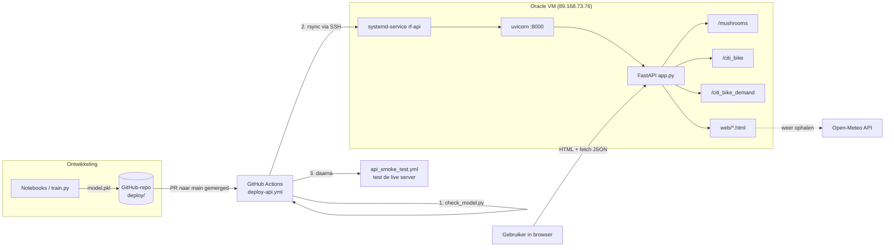

# CloudAI Challenge

## Team & Auteurs
* **Teamnaam:** Git Push & Pray
* **Leden:**
  * Dmitrij Tchervonisjenko
  * Kobe Vandenberk
  * Cisse Vandeweyer
  * Brent Van Gelder

---

## 📌 Projectoverzicht
In dit project analyseren en modelleren we twee complexe datasets rondom het thema "Going Green". We hebben gefocust op grondige datakwaliteit, statistische hypothesetoetsing en verantwoorde evaluatiemetrics.

1. **Mushroom Dataset (`mushrooms/`)**
   * **Doel:** Binaire classificatie om te voorspellen of een paddenstoel giftig of eetbaar is.
   * **Aanpak:** 95% missing columns en redundante ruis verwijderd, feature engineering toegepast (`stem-volume`, `cap-diameter-sq`), en getraind met een Stacking Ensemble (DT, RF, GBC, XGBoost).
   * **Beslissing:** Kans-drempel verlaagd naar een veilige threshold (0.194) om dodelijke False Negatives (giftig gezien als eetbaar) drastisch terug te dringen (Recall > 94%).

2. **NYC Citi Bike System Data (`citi_bike/`)**
   * **Doel:** Twee complementaire vraagstukken op 328 miljoen ritten:
     * **Ritduurvoorspelling (Brent):** Voorspellen van de ritduur in minuten bij vertrek (`HistGradientBoosting` met L1-loss, MAE: 3.51 min).
     * **Vraagvoorspelling per Zone (Kobe):** Voorspellen van het aantal vertrekken per zone/uur (`HistGradientBoosting` met Poisson-loss, R²: 0.931).
   * **Statistiek:** Hypotheses formeel bewezen (o.a. dat casuals significant langer fietsen en regen de vraag met 27% verlaagt).

---

## 📁 Mappenstructuur & Notebooks

* **`final/`**: Bevat de definitieve, opgeschoonde notebooks voor evaluatie:
  * `final/mushrooms/`: Volledige dataverkenning, tuning en het finale stacking-model.
  * `final/citi_bike/citi_bike_duration/`: Ritduurmodel van Brent (cleaning, hypotheses, tuning).
  * `final/citi_bike/citi_bike_demand/`: Vraagvoorspellingsmodel van Kobe (KMeans clustering, Poisson-regressie).
* **Individuele mappen (`Brent/`, `Cisse/`, `Dimi/`, `Kobe/`)**: Werkmappen van elk teamlid voor onafhankelijke experimenten.
* **`deploy/`**: Productie-omgeving met de FastAPI-backend, HTML-webinterfaces en geëxporteerde `.pkl` modellen.

---

# 🚀 Deployment van onze modellen

Deze map (`deploy/`) bevat alles wat op de server draait: één webserver die onze drie modellen als API aanbiedt, plus de webpagina's om ze te gebruiken. Dit gedeelte legt uit **wat** er gebruikt wordt, **hoe** het werkt en **hoe** een nieuw model automatisch op de server komt.

**Live adres:** <http://89.168.73.76:8000>, met de API-documentatie op <http://89.168.73.76:8000/docs>.

---

## 1. Overzicht in één beeld



In woorden:
1. Een teamlid traint een model in een notebook en slaat het op als `.pkl` in `deploy/<model>/`.
2. Een pull request naar `main` die iets in `deploy/` wijzigt en gemerged wordt, start automatisch de workflow **deploy-api.yml**.
3. Die workflow **test eerst** alle modellen en de API. Pas als alles slaagt, kopieert hij de map naar de VM en herstart hij de service. Start de nieuwe versie niet, dan zet hij de vorige versie terug (**rollback**).
4. Daarna test **api_smoke_test.yml** de echte server via internet (ook elke dag om 7u UTC).

---

## 2. Wat staat er in deze map?

```text
deploy/
├── app.py                  -> start de API: koppelt de drie modellen + serveert de webpagina's
├── requirements.txt        -> Python-pakketten voor de server (vaste versies!)
├── check_model.py          -> test alle modellen en endpoints vóór elke deploy
├── UITLEG.md               -> dit bestand
├── mushrooms/
│   ├── api.py              -> endpoints /mushrooms/...
│   └── stacking.pkl        -> het gebruikte model (StackingClassifier)
│       (mushroom_xgb_model.pkl en model_columns.pkl worden niet geladen)
├── citi_bike/              -> ritduur bij vertrek (model van Brent)
│   ├── api.py              -> endpoints /citi_bike/...
│   ├── model.pkl           -> bundle met HistGradientBoosting + routegeschiedenis
│   └── stations.json       -> 2.423 huidige stations (id, naam, coördinaten) voor de kaart
├── citi_bike_demand/       -> vraag per zone per uur (model van Kobe)
│   ├── api.py              -> endpoints /citi_bike_demand/...
│   └── model.pkl           -> bundle met HistGradientBoosting (Poisson) + 30 zones
└── web/
    ├── index.html          -> keuzepagina: mushrooms of Citi Bike
    ├── citi_bike_models.html -> keuzepagina tussen de twee Citi Bike-modellen
    ├── mushrooms.html      -> formulier mushroom-model
    ├── citi_bike.html      -> ritduur: kaart, start/bestemming, weer
    └── citi_bike_demand.html -> vraag: kaart met zones, datum, weerscenario, grafiek per uur
```

---

## 3. Gebruikte technologie en waarom

| Onderdeel | Wat | Waarom gekozen |
|---|---|---|
| **Oracle Cloud VM** | Gratis (Always Free) Ubuntu-server, gebruiker `ubuntu`, IP 89.168.73.76 | Gratis, altijd online, volledige controle (geen beperkingen van een PaaS). |
| **FastAPI** | Python-webframework voor de API | Snel, valideert de invoer automatisch met Pydantic en maakt zelf de Swagger-documentatie (`/docs`). |
| **Pydantic** | Beschrijft per endpoint welke velden en welke waarden toegelaten zijn | Foute invoer (bv. `member_casual: "iemand"` of negatieve neerslag) geeft meteen een duidelijke **422**-fout in plaats van een crash of een onzinnige voorspelling. |
| **uvicorn** | De webserver die de FastAPI-app draait op poort 8000 | Standaard ASGI-server voor FastAPI. |
| **systemd** (`rf-api`) | Linux-service die uvicorn start en bewaakt | Start automatisch na een herstart van de VM en kan herstart worden met `sudo systemctl restart rf-api`; logs via `journalctl -u rf-api`. |
| **Python-venv** | Aparte Python-omgeving op de VM (`~/rf-api/venv`) | Geen conflicten met de systeem-Python; wordt bij elke deploy bijgewerkt met `requirements.txt`. |
| **joblib / pickle** | Formaat van de `.pkl`-modelbestanden | Standaard voor scikit-learn-modellen. Nadeel: alleen leesbaar met dezelfde scikit-learn-versie (zie §6). |
| **scikit-learn, numpy, pandas, xgboost** | De bibliotheken die de modellen nodig hebben | Moeten dezelfde zijn als bij het trainen. |
| **GitHub Actions** | Automatische test- en deploy-workflows | Elke wijziging gaat via dezelfde gecontroleerde weg naar de server; niemand hoeft handmatig in te loggen. |
| **SSH + rsync** | Bestanden veilig naar de VM kopiëren | rsync kopieert alleen wat veranderd is; SSH met een sleutel uit de GitHub-secret `VM_SSH_KEY`. |
| **Vanilla HTML/CSS/JS** | De webpagina's, zonder framework | Geen build-stap nodig; FastAPI serveert ze rechtstreeks uit `web/`. |
| **Leaflet + OpenStreetMap** | Interactieve kaarten op de Citi Bike-pagina's | Gratis, geen API-sleutel nodig. |
| **Open-Meteo** | Weervoorspelling en weerarchief, opgehaald door de browser | Gratis, geen sleutel. Het is dezelfde bron als de weerdata waarmee de Citi Bike-modellen getraind zijn. |

---

## 4. Hoe de API werkt (`app.py`)

`app.py` is het startpunt. Uvicorn start het met `uvicorn app:app --host 0.0.0.0 --port 8000`.

1. **Modellen laden bij het opstarten.** `app.py` importeert de drie `api.py`-bestanden en elk daarvan laadt meteen zijn `.pkl`. Is een model kapot of met een verkeerde versie opgeslagen, dan **start de API niet**. Dat is bewust: de deploy-workflow merkt dat dan en zet de vorige versie terug.
2. **Routers koppelen.** Elk model krijgt een eigen prefix: `/mushrooms`, `/citi_bike` en `/citi_bike_demand`. Elk model staat zo in een eigen map en de teamleden zitten elkaar niet in de weg.
3. **Optionele API-sleutel.** Als op de server de omgevingsvariabele `API_KEY` gezet is, vraagt elke POST de header `X-API-Key`. Zonder die variabele is de API open, zodat de webpagina's werken.
4. **CORS open** (`allow_origins=["*"]`). Een webpagina op een ander adres, of een lokaal geopend HTML-bestand, mag de API ook aanroepen.
5. **Geen oude pagina's in de cache.** HTML-antwoorden krijgen `Cache-Control: no-cache`, dus na een deploy ziet iedereen meteen de nieuwe pagina.
6. **`/health`.** Geeft `{"status":"ok"}` met de geladen modelbestanden. De deploy-workflow en de smoke test gebruiken dit om te zien of de server werkt.
7. **Webpagina's.** Alles wat geen API-route is, komt uit `web/`, met `index.html` op `/`.

### Alle adressen

| Route | Methode | Wat |
|---|---|---|
| `/` | GET | Keuzepagina |
| `/mushrooms.html`, `/citi_bike_models.html`, `/citi_bike.html`, `/citi_bike_demand.html` | GET | Webpagina's |
| `/health` | GET | Status + geladen modellen |
| `/docs` | GET | Swagger: alle endpoints uitproberen in de browser |
| `/mushrooms/` | GET | Model-info: kenmerken en toegelaten categorieën |
| `/mushrooms/predict` | POST | Eetbaar (0) of giftig (1) + kansen |
| `/citi_bike/` | GET | Model-info: kenmerken, metrics, trainingsperiode |
| `/citi_bike/stations` | GET | Lijst van stations voor de kaart |
| `/citi_bike/predict` | POST | Verwachte ritduur in minuten |
| `/citi_bike_demand/` | GET | Model-info + de 30 zones |
| `/citi_bike_demand/predict` | POST | Verwachte vertrekken in één zone in één uur |
| `/citi_bike_demand/predict_day` | POST | Verwachte vertrekken per uur voor een hele dag (24 waarden) |

### Het "bundle"-principe

De twee Citi Bike-modellen zijn opgeslagen als een **bundle**: een Python-dict met meer dan alleen het model.

| Sleutel | Inhoud |
|---|---|
| `model` | De getrainde scikit-learn-pipeline |
| `model_name` | Naam die op de webpagina en in `/` getoond wordt |
| `features` | De exacte kolommen in de juiste volgorde |
| `metrics` | Fout op de testset; de webpagina toont de MAE als "gemiddelde fout" |
| `trained_at_utc`, `limitations`, … | Uitleg voor de gebruiker |
| `route_history` (ritduur) | Typische duur per route en per station uit de trainingsperiode |
| `zones` (vraag) | Naam, middelpunt en aantal stations per zone |

Voordeel: de API leest alles uit het bestand zelf. Wie een beter model traint met hetzelfde formaat, vervangt alleen `model.pkl`; de code hoeft niet te veranderen. De API controleert bij het laden of alle verplichte sleutels aanwezig zijn.

---

## 5. De drie modellen in de API

### 5.1 Mushrooms (`mushrooms/api.py`)
- **Model:** `stacking.pkl`, een scikit-learn `StackingClassifier` met preprocessing (imputer + one-hot-encoder) in de pipeline.
- **Zelf-beschrijvend:** de API haalt de kolommen en de toegelaten categorieën **uit het model zelf** (uit de `ColumnTransformer` en `OneHotEncoder`). Een ander model met andere kolommen werkt dus zonder codewijziging.
- **Vriendelijke invoer:**
  - Zowel de code (`"w"`) als het woord (`"white"`) wordt aanvaard.
  - `cap-diameter`, `cap_diameter` en `cap_diameter_cm` betekenen hetzelfde.
  - Een ontbrekende waarde wordt door het model ingevuld.
- **Uitvoer:** `prediction` (de klasse met de hoogste kans) en `probabilities` voor 0 en 1.

> ⚠️ **Open punt: de drempel van 15% wordt (nog) niet toegepast.**  
> De projectbeschrijving (README) zegt dat we een paddenstoel als giftig markeren zodra de kans op giftig ≥ 15% is. De API doet dat nu niet: `prediction` is de klasse met de hoogste kans, dus in feite een drempel van 50%. De webpagina neemt die `prediction` over.
>
> Wat dat betekent voor het model op de server (`stacking.pkl`). We hebben dit nagemeten op de testset, met dezelfde 70/20/10-split als in `mushrooms/Cisse/3-Models-Final.ipynb` (seed 42, 500 paddenstoelen):
>
> | Drempel | Giftig gemist (eetbaar genoemd) | Eetbare weggegooid | Accuracy |
> |---|---|---|---|
> | 0,50 (huidige API) | 53 van 189 (28%) | 54 van 311 | 0,79 |
> | 0,194 (Cisses keuze op validatie: ≥ 95% giftig herkend) | 8 van 189 (4%) | 211 van 311 | 0,56 |
> | 0,15 (README) | 2 van 189 (1%) | 265 van 311 | 0,47 |
>
> - De drempel maakt het model **veiliger, niet beter**. Bij 15% wordt bijna elke giftige paddenstoel herkend, maar ook ±85% van de eetbare wordt afgekeurd.
> - De 15% komt uit Dimi's XGBoost-notebook, dus van een ander model. De 0,194 is gekozen op validatiedata van dit stacking-model zelf.
> - Om het toe te passen zijn vier aanpassingen nodig:
>   - `mushrooms/api.py`: `prediction = 1` als de kans op giftig ≥ drempel, en de drempel meegeven in het antwoord;
>   - `web/mushrooms.html`: de drempel vermelden;
>   - `check_model.py`: een controle toevoegen dat de drempel gebruikt wordt;
>   - dit document bijwerken.
> - Het mushroom-model is van Cisse; deze keuze laten we bij Cisse en het team.

### 5.2 Citi Bike: ritduur bij vertrek (`citi_bike/api.py`, model van Brent)
- **Model:**
  - `HistGradientBoostingRegressor` (absolute error) achter een `ColumnTransformer`, met 30 kenmerken.
  - Testset (juni 2025 – september 2026): MAE ≈ 3,5 minuten, R² ≈ 0,45.
- **Invoer:**
  - vertrekmoment;
  - type fiets (`classic_bike` / `electric_bike`);
  - `member` of `casual`;
  - startstation en bestemming (id + coördinaten);
  - optioneel het weer (temperatuur, luchtvochtigheid, neerslag, wind).
- **Kenmerken berekenen:** `make_features()` en `apply_history()` doen exact hetzelfde als `build.py` en `history.py` in Brents project. Die code gaat niet mee naar de server, daarom staat ze hier opnieuw:
  - afstand in vogelvlucht en "Manhattan-afstand" langs het 29° gedraaide stratenrooster;
  - rijrichting;
  - uur, weekdag en maand als sinus/cosinus;
  - weekend en Amerikaanse feestdag;
  - typische duur op die route en van/naar die stations, met smoothing voor routes met weinig ritten.
- **Ontbrekend weer:** wordt `NaN`; het model vult dan de mediaan uit de training in (18 °C, droog).
- **Uitvoer:**
  - voorspelling in minuten, begrensd tot 0–180;
  - afstand;
  - hoeveel ritten er op die route in de historiek zaten;
  - of het weer meegegeven was.

### 5.3 Citi Bike: vraag per zone per uur (`citi_bike_demand/api.py`, model van Kobe)
- **Model:**
  - `HistGradientBoostingRegressor` met Poisson-loss (geschikt voor tellingen).
  - Testset: MAE ≈ 29 vertrekken per uur, R² ≈ 0,93.
  - De 30 zones zijn gemaakt met KMeans op de stationscoördinaten.
- **Kenmerken (12):**
  - zone;
  - uur, weekdag en maand;
  - weekend en feestdag;
  - temperatuur, neerslag, wind en sneeuw op de grond;
  - jaar;
  - aantal actieve stations in de zone. De API vult hier het **huidige** aantal in, want voorspellingen gaan over nu of de toekomst.
- **`/predict_day`:** krijgt een datum en 24 weer-uren en geeft 24 voorspellingen terug. De webpagina maakt daar de staafgrafiek van.
- **Validatie:**
  - een onbekende zone geeft 422;
  - het weer moet binnen realistische grenzen liggen: −30 tot 45 °C, 0–100 mm neerslag, 0–150 km/u wind en 0–300 cm sneeuw.

---

## 6. Waarom vaste versies? (`requirements.txt`)

```text
scikit-learn==1.4.2
numpy==1.26.4
xgboost-cpu==3.2.0
joblib, pandas, fastapi, uvicorn
```

Een `.pkl` is een "foto" van Python-objecten. Die kan alleen terug ingelezen worden door **dezelfde versie** van de bibliotheek die het object maakte. Een model opgeslagen met scikit-learn 1.6 gaf op de server bijvoorbeeld deze fout: `Can't get attribute '_RemainderColsList'`. Die klasse bestaat pas vanaf 1.5.

Omdat de drie modellen **in hetzelfde proces** draaien, moeten ze allemaal met dezelfde versie opgeslagen zijn. We kozen **scikit-learn 1.4.2 + numpy 1.26.4**, omdat PyCaret 3.3 (gebruikt in de notebooks) niets nieuwers toelaat. Een nieuw model trainen voor de server = trainen in een omgeving met precies deze versies.

---

## 7. Automatisch deployen: `.github/workflows/deploy-api.yml`

**Wanneer?**
- Als een pull request naar `main` **gemerged** wordt en iets in `deploy/` (of de workflow zelf) wijzigt.
- Handmatig via *Actions → Deploy model-API naar Oracle VM → Run workflow*.

Een gesloten PR die niet gemerged is, wordt overgeslagen. Er draaien nooit twee deploys tegelijk (`concurrency`).

> ⚠️ Een commit die je pusht **nadat** de PR al gemerged is, komt niet op de server. Daarvoor is een nieuwe PR nodig.

### Job 1: `check` (op een GitHub-server, nog niets op de VM)
1. Precies de gemergede commit uitchecken.
2. Opzoeken welke `.pkl`-bestanden in de PR nieuw of gewijzigd zijn (komt in de samenvatting van de run).
3. Python 3.12 + `requirements.txt` installeren. Dat zijn dezelfde versies als op de VM.
4. **`check_model.py` uitvoeren** (zie §8). Faalt er één test, dan stopt alles en blijft de server ongewijzigd.
5. Controleren of elk nieuw `.pkl` ook echt geladen wordt door de API. Een model met een verkeerde bestandsnaam zou anders ongemerkt nooit gebruikt worden.

### Job 2: `deploy` (alleen als `check` geslaagd is)
1. **SSH instellen** met de private sleutel uit de secret `VM_SSH_KEY`. Base64 of gewone tekst kan allebei. Een beschadigde sleutel geeft een duidelijke foutmelding, zonder de sleutel te tonen.
2. **Reservekopie** op de VM: `~/rf-api` wordt gekopieerd naar `~/rf-api.prev` (zonder de venv).
3. **Kopiëren:** `rsync` stuurt de inhoud van `deploy/` naar `~/rf-api` op de VM.
4. **Installeren en herstarten:**
   - `pip install -r requirements.txt` in de venv;
   - `sudo systemctl restart rf-api`;
   - tot 2 minuten wachten tot `http://localhost:8000/health` antwoordt.
5. **Rollback** als de installatie of de start mislukt:
   - de laatste logregels tonen (`journalctl`);
   - `~/rf-api.prev` exact terugzetten (`rsync --delete`), opnieuw installeren en herstarten;
   - de run als mislukt markeren.

   De server blijft dus altijd draaien met de laatste werkende versie.

### Daarna: `.github/workflows/api_smoke_test.yml`
Draait na elke geslaagde deploy, elke dag om 7u UTC en handmatig. Het test de **echte** server via internet:
- `/health`;
- alle webpagina's;
- model-info van alle drie de modellen;
- een voorbeeldvoorspelling per model, met controle of het antwoord zinvol is (bv. ritduur tussen 0 en 180 minuten);
- foute invoer moet 422 geven.

---

## 8. Testen vóór de deploy: `check_model.py`

Dit script start de volledige app **in het geheugen** met FastAPI's `TestClient` (geen echte server nodig) en voert tientallen controles uit. Bij de eerste fout stopt het met exitcode 1, waardoor de workflow stopt.

| Wat | Voorbeelden |
|---|---|
| Algemeen | `/health` is ok; alle 5 webpagina's geven HTML |
| Mushrooms | model-info klopt; klassen zijn 0 en 1; **elke** toegelaten categorie geeft een voorspelling; kansen tellen op tot 1; foute waarde → 422 |
| Ritduur | meer dan 1000 stations; voorspellingen voor een gewone rit, een e-bike van een casual, zonder weer, met onbekende stations en op een feestdag laat op de avond liggen allemaal tussen 0 en 180 min; **verdere bestemming → langere rit**; foute invoer of geen bestemming → 422 |
| Vraag | voorspelling voor **elke** zone; **spits > nacht en spits > stortregen**; `predict_day` geeft 24 uren; onbekende zone of negatieve neerslag → 422 |

Naast "werkt het technisch?" controleren we dus ook of het model **logisch** gedrag toont (de "sanity checks"). Zo houden we een model tegen dat wel laadt maar onzin voorspelt.

Lokaal uitvoeren:

```bash
pip install -r deploy/requirements.txt httpx
python deploy/check_model.py deploy
```

---

## 9. De webpagina's

- **Geen eigen server nodig:** de pagina's zijn gewone HTML-bestanden met JavaScript. Ze praten met de API via `fetch()` en JSON.
- **Welk API-adres?** De pagina's gebruiken het adres waarvan ze geladen werden. Is een bestand lokaal geopend (`file://`), dan valt de pagina terug op `http://89.168.73.76:8000`. Met `?api=http://localhost:8000` in de URL kies je een andere API, handig om lokaal te testen.
- **Weer automatisch:**
  - De browser haalt het weer per uur bij **Open-Meteo**.
  - Tot 16 dagen vooruit komt het uit de voorspelling; voor oudere data (meer dan 60 dagen geleden) uit het archief.
  - Lukt dat niet, dan rekent de ritduurpagina met de mediaan uit de training. De vraagpagina valt terug op 15 °C, droog en geen sneeuw.
- **Weerscenario's:** op beide Citi Bike-pagina's kies je "echt weer" of een scenario. Een scenario past alleen aan wat erbij hoort (bv. sneeuw → hooguit 0 °C); de rest van het echte weer blijft.

  | Pagina | Scenario's |
  |---|---|
  | Ritduur | droog 18 °C, regen, zware regen, sneeuw, hitte 33 °C |
  | Vraag | droog, hele dag regen, zware regen, sneeuw op straat, sneeuwstorm |

  - Op de ritduur heeft het weer weinig effect: hooguit ± 0,6 minuut.
  - Op de vraag is het effect groot: regen tot −60%, een sneeuwstorm zelfs ±−95%.
- **Kaarten (Leaflet):**
  - **Ritduurpagina:** klik je startstation en bestemming aan op de kaart, of zoek op naam.
  - **Vraagpagina:** klik op een zone; een grotere cirkel betekent meer ritten.
- **Responsief:** werkt op desktop en op gsm-breedte.

---

## 10. Praktisch

### Lokaal draaien
```bash
cd deploy
pip install -r requirements.txt
uvicorn app:app --port 8000
# open http://localhost:8000  en  http://localhost:8000/docs
```

### Een nieuw model op de server zetten
1. Train het model in een omgeving met **scikit-learn 1.4.2 en numpy 1.26.4**. Voor het vraagmodel kan dat met `python citi_bike/Kobe/train.py`, dat het nieuwe `deploy/citi_bike_demand/model.pkl` wegschrijft.
2. Vervang het bestand in `deploy/<model>/` **met dezelfde naam**: `stacking.pkl` of `model.pkl`. Voor de Citi Bike-modellen: hetzelfde bundle-formaat.
3. Test lokaal: `python deploy/check_model.py deploy`.
4. Push naar een branch, maak een pull request naar `main` en merge.
5. Volg de run in het tabblad **Actions**: `check` → `deploy` → `API Smoke Test`.

### Problemen oplossen
| Symptoom | Oorzaak / oplossing |
|---|---|
| Workflow faalt bij "Modellen laden en testen" met `Can't get attribute ...` | Model opgeslagen met een andere scikit-learn-versie → opnieuw opslaan met 1.4.2. |
| Workflow faalt bij "Gebruikt de API de nieuwe modellen?" | Het nieuwe `.pkl` heeft een andere naam dan wat de API laadt → hernoemen. |
| Server toont nog de oude versie | De wijziging zit niet in `main` (bv. gepusht na de merge) → nieuwe PR. Of de deploy is teruggedraaid → bekijk de logs van de run. |
| Fout `VM_SSH_KEY is geen geldige private sleutel` | Secret opnieuw aanmaken met `base64 -w0 ~/github_deploy_key`. |
| API reageert niet | Op de VM: `sudo systemctl status rf-api` en `sudo journalctl -u rf-api -n 50`. |

### Beveiliging
- De SSH-sleutel staat alleen als **GitHub-secret**, nooit in de code.
- Alle invoer wordt gevalideerd (Pydantic) voordat ze het model bereikt.
- Optioneel kan een API-sleutel (`API_KEY`) verplicht gemaakt worden voor voorspellingen.
- Elke deploy is eerst getest en kan automatisch teruggedraaid worden.