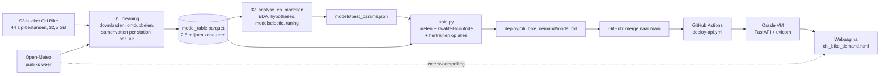
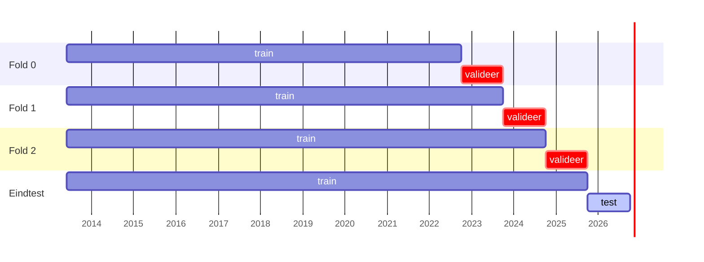
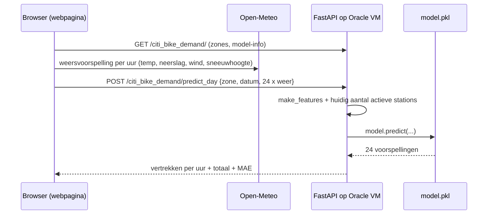

# Citi Bike: vraag per zone per uur. Volledige uitleg

Dit document legt **alles** uit wat in het Citi Bike-deel van het project gebruikt is: de data, elke cleaningstap, elke techniek, elke statistische toets, elk model, de deployment en de tools. Bij elk onderdeel staat **wat** het is, **waarom** we het gebruikten en **wat** het opleverde. De cijfers komen uit de uitgevoerde notebooks in deze map:

- [`01_cleaning.ipynb`](01_cleaning.ipynb): van de ruwe bestanden naar de modeltabel;
- [`02_analyse_en_modellen.ipynb`](02_analyse_en_modellen.ipynb): EDA, hypotheses, modellen, foutenanalyse en deployment.

## Inhoud

1. [De vraag en het antwoord in het kort](#1-de-vraag-en-het-antwoord-in-het-kort)
2. [Het geheel in één schema](#2-het-geheel-in-één-schema)
3. [De data](#3-de-data)
4. [Cleaning: van 329 miljoen ritten naar een modeltabel](#4-cleaning-van-329-miljoen-ritten-naar-een-modeltabel)
5. [Unsupervised learning: KMeans](#5-unsupervised-learning-kmeans)
6. [EDA: wat bepaalt de vraag?](#6-eda-wat-bepaalt-de-vraag)
7. [Statistiek: de hypotheses](#7-statistiek-de-hypotheses)
8. [Hoe we modellen eerlijk meten](#8-hoe-we-modellen-eerlijk-meten)
9. [De modellen](#9-de-modellen)
10. [Van 2024 naar alle data](#10-van-2024-naar-alle-data)
11. [Foutenanalyse](#11-foutenanalyse)
12. [Deployment](#12-deployment)
13. [Wat niet werkte, en wat we ervan leerden](#13-wat-niet-werkte-en-wat-we-ervan-leerden)
14. [Tools en versies](#14-tools-en-versies)
15. [Begrippenlijst](#15-begrippenlijst)
16. [Oefenvragen voor het mondeling](#16-oefenvragen-voor-het-mondeling)
17. [Bestanden](#17-bestanden)

---

## 1. De vraag en het antwoord in het kort

**Vraag:** hoeveel Citi Bikes vertrekken er in een bepaalde **zone** van New York in een bepaald **uur**?

**Waarom die vraag:** Citi Bike moet elke dag fietsen herverdelen. 's Ochtends lopen de stations in woonbuurten leeg en die in kantoorwijken vol, 's avonds omgekeerd. Wie de vraag per buurt en per uur kan voorspellen, kan op tijd fietsen verplaatsen. Een leeg station in de spits is een gemiste groene rit (thema *Going green*).

**Antwoord:** een **gradient boosting-model** (scikit-learn `HistGradientBoostingRegressor` met Poisson-verlies), getraind op **alle 329 miljoen ritten** van juni 2013 tot september 2026, met kalender, weer en de grootte van het netwerk als kenmerken.

| | Resultaat op de testset (oktober 2025 – september 2026) |
|---|---|
| Gemiddelde fout (MAE) | **28,9 vertrekken per zone per uur** |
| Relatieve fout | **16,7%** van de gemiddelde vraag (173 per zone-uur) |
| R² | **0,931** |
| Ter vergelijking: baseline | MAE 71,0, R² 0,68 |

Het model staat in een API op een Oracle-server, met een webpagina waar je een zone en een dag kiest en de verwachte vertrekken per uur ziet.

---

## 2. Het geheel in één schema

Het werk zit in twee notebooks. De verwerkingscode staat in één bestand, [`../citibike.py`](../citibike.py). Zo doen de notebooks, `train.py` en de API exact hetzelfde met de data.

---

## 3. De data

### 3.1 Ritdata van Citi Bike
- **Bron:** de officiële publieke bucket `https://s3.amazonaws.com/tripdata/`, zonder login.
- **Inhoud:** één rij per rit: starttijd, eindtijd, start- en eindstation (naam, id, coördinaten), type gebruiker (member of casual), en sinds 2020 het fietstype (klassiek of elektrisch).
- **Omvang:** 44 NYC-bestanden (32,5 GB gezipt), juni 2013 – september 2026, samen **328,8 miljoen ritten**.
- **Opbouw:**
  - 2013–2023: één zip per jaar, met mappen of zip's per maand;
  - vanaf 2024: één zip per maand, met CSV-delen van ± 1 miljoen rijen.
- **Weggelaten:** 133 `JC-…`-bestanden. Dat is Jersey City, een apart systeem.

### 3.2 Weerdata van Open-Meteo
- **Wat:** Open-Meteo is een gratis weer-API zonder sleutel. Het **archief** gebruiken we voor de training, de **voorspelling** gebruikt de webpagina.
- **Variabelen per uur:** temperatuur, neerslag, wind, sneeuwval, luchtvochtigheid en **sneeuwhoogte** (cm sneeuw op de grond).
- **Eén punt voor heel NYC** (40,73° N, 73,97° W), in **lokale tijd**, zodat het klopt met de ritdata.
- **Zomertijd:** in maart ontbreekt één uur en in november komt één uur twee keer voor. We ontdubbelen en vullen dat ene uur in met interpolatie.

### 3.3 Waarom ritdata en weer volstaan, en wat ontbreekt
Uit de ritten weten we **wanneer** en **waar** er vertrokken werd. Het weer verklaart een groot deel van de schommelingen (zie §7). Wat niet in de data zit:
- evenementen (marathon, concerten);
- wegenwerken;
- hoeveel fietsen er in een station beschikbaar waren.

Die beperkingen komen terug in §11.

---

## 4. Cleaning: van 329 miljoen ritten naar een modeltabel

Het eindresultaat is één tabel met één rij per **zone** per **uur**: het aantal vertrekken, het weer, de kalender en het aantal actieve stations. In totaal 2.818.992 rijen (27,8 MB).

### 4.1 Downloaden met controle
- Een bestand wordt eerst naar `.part` geschreven en pas hernoemd als de grootte klopt. Een afgebroken download wordt zo nooit voor een geldige zip aangezien.
- Van elk bestand bewaren we een **SHA-256-checksum** in `manifest.json`: een vingerafdruk van het bestand. Iedereen kan zo controleren dat hij exact dezelfde data heeft.
- Wat er al volledig staat, wordt niet opnieuw gedownload.

### 4.2 Dubbele maanden in de jaarbestanden
De zip's van **2013** en **2018** bevatten elke maand twee keer: één keer als los bestand en één keer opgesplitst in een maandmap. Voor september 2013 bevatten beide versies exact **1.034.359** ritten, en elke rit (starttijd, start- en eindstation) komt in beide voor.

**Keuze:** per maand één versie houden. De functie `select_csvs` kiest de versie in de diepste map, zoals in alle andere jaren. Zo zijn 21 dubbele bestanden weggelaten. Zonder die stap zouden 2013 en 2018 dubbel tellen.

### 4.3 Drie generaties kolomnamen
| Periode | Kolommen (begin) |
|---|---|
| 2013–2019 | `tripduration, starttime, stoptime, start station id, …, usertype, birth year, gender` |
| sommige bestanden 2016–2017 | `Trip Duration, Start Time, Stop Time, …` |
| vanaf 2020 | `ride_id, rideable_type, started_at, ended_at, …, member_casual` |

**Keuze:** alles omzetten naar het schema van vandaag (`standardize_columns`):
- `starttime` en `Start Time` worden `started_at`;
- `usertype` wordt `member_casual` (*Subscriber* → member, *Customer* → casual);
- wat vroeger niet bestond, wordt leeg (`ride_id`) of `unknown` (`rideable_type`).

### 4.4 Drie datumnotaties
`2013-06-01 00:00:01` (ISO), `10/1/2014 00:00:27` en `1/1/2015 0:01`. In 2014–2016 wisselt de notatie zelfs per bestand.

**Keuze:** per stuk van 500.000 rijen de eerste notatie nemen die (bijna) alles kan lezen.
- **Waarom niet per rij laten raden?** Dat is tientallen keren trager en kan dag en maand verwisselen.
- **Bewijs dat het werkt:** in geen enkel jaar is er een rit met een onleesbare starttijd.

### 4.5 Samenvatten in stukken (chunking)
329 miljoen ritten passen niet in het geheugen van een laptop. Elk bestand wordt daarom in stukken van 500.000 rijen gelezen, en per stuk houden we alleen bij:
- het aantal vertrekken per station per uur;
- een stationslijst;
- een audit (wat er ontbreekt, wat werd weggelaten);
- een steekproef van 0,2% van de ritten.

Het resultaat wordt per bronbestand weggeschreven als **Parquet**, een compact kolomformaat. Een onderbroken run kan zo hervatten.

### 4.6 Wat telt als een vertrek?
| Vaststelling | Aantal | Keuze | Waarom |
|---|---|---|---|
| geen startstation (en dus geen locatie) | ± 92.000 | weg | geen zone te bepalen |
| geen eindstation | | behouden | de fiets is wél vertrokken |
| startlocatie buiten NYC | 256 | weg | foute coördinaten |
| negatieve ritduur | ± 2.000, telkens in november | behouden | klokwissel: een rit van 1:50 (zomertijd) tot 1:10 (wintertijd) lijkt negatief |
| rit langer dan 24 uur | ± 158.000 | behouden | is nog altijd een vertrek |
| "dubbele" rijen (2013–2017) | ± 56.000 | behouden | geen ritnummer, soms tijd tot op de minuut: groepsritten zien er identiek uit |

**Waarom geen filter op ritduur?** Wij tellen **vertrekken**: elke rit telt één keer, hoe lang ze ook duurt. Bij een model dat de *ritduur* voorspelt, zou je extreme ritten wél moeten aanpakken.

Resultaat: **99,97%** van de ritten is bruikbaar als vertrek.

### 4.7 Station-id's
- **Kommagetal:** sommige CSV's bewaarden de id als getal. Daardoor werd `3423.10` → `3423.1` en `119` → `119.0`. De functie `normalize_station_id` herstelt dat, afhankelijk van de periode.
- **Twee stelsels:** tot 2021 gehele getallen (`72`), daarna codes met een punt (`6926.01`). Hetzelfde station kreeg een nieuwe id.
- **Keuze:** stations zoveel mogelijk via hun **locatie** behandelen. Een station krijgt de zone van zijn coördinaten, en actieve stations tellen we als unieke locaties (op ± 10 m).
- **Bewijs:** als we id's tellen, staan in december 2019 **124 stations dubbel**. Enkele ritten in het bestand van 2020 begonnen in december 2019 en gebruiken al de nieuwe id.

### 4.8 Welke stations tellen mee?
Weggelaten: **interne locaties** (werkplaatsen, depots, laadkades, testlocaties zoals *Morgan Bike Mechanics*, *NYCBS Depot*, `Lab - NYC`) en stations van **Jersey City/Hoboken**. Samen zijn dat 110 id's en 18.813 vertrekken, minder dan 0,01%.

**Waarom:** een fiets die uit een werkplaats "vertrekt", is onderhoud of herverdeling, geen klantenvraag.

### 4.9 Dagen waarop het systeem dicht was
We vergelijken elke dag met de mediaan van de 4 weken eromheen. **12 dagen** liggen onder 3% van normaal: allemaal sneeuwstormen waarop Citi Bike het systeem stillegde (o.a. 23–26 januari 2016, 14–16 maart 2017, 1–2 februari 2021, 23 februari 2026).

**Keuze:** die dagen weglaten.
- **Waarom:** er was geen aanbod, dus "0 vertrekken" zegt niets over de vraag.
- **Wat blijft:** echt rustige dagen (zware regen, sneeuw, Kerstmis). Die moet het model wél leren.

### 4.10 Zones, aanbod, rooster, weer en split
| Stap | Keuze | Waarom |
|---|---|---|
| zones | 30 zones met KMeans (§5) op het netwerk van de laatste 12 maanden | per station is er te veel toeval; het model voorspelt de stad van vandaag |
| actieve stations | aantal unieke locaties met ≥ 1 vertrek per zone per maand = **kenmerk** | het netwerk groeide van 330 naar ± 2.400 stations |
| zone-uren zonder aanbod | weg | in 2014 was er in de Bronx geen vraag te meten, niet "0 vraag" |
| rooster | elke zone × elk uur, uren zonder vertrek = 0 | anders leert het model alleen van uren met vraag en overschat het |
| weer | per uur erbij, inclusief sneeuwhoogte | belangrijkste factor buiten de kalender (§7) |
| split | test = laatste 12 maanden | meten zoals het model gebruikt wordt (§8) |

**Controle:** de som van alle vertrekken in de tabel is exact gelijk aan alle vertrekken van de publieke stations, buiten de 12 gesloten dagen. Er gaat niets verloren.

---

## 5. Unsupervised learning: KMeans

**KMeans** verdeelt punten in *k* groepen, zodat elk punt zo dicht mogelijk bij het centrum van zijn groep ligt. Het algoritme kiest centra, wijst elk punt toe aan het dichtstbijzijnde centrum, verplaatst de centra naar het gemiddelde van hun punten, en herhaalt dat tot er niets meer verandert. Het is *unsupervised*: er is geen "juist antwoord", het algoritme zoekt zelf structuur.

We gebruikten KMeans twee keer.

### 5.1 Zones: stations groeperen op locatie
- **Invoer:** de coördinaten van de stations, omgerekend naar km (zodat noord-zuid en oost-west even zwaar wegen).
- **Gewogen met het aantal ritten** (`sample_weight`): de centra komen dichter bij elkaar waar veel gefietst wordt. Drukke buurten krijgen zo kleinere zones.
- **Op het netwerk van de laatste 12 maanden** (2.433 stations): het model voorspelt de toekomst.

**Hoeveel zones?**

| k | silhouette | mediaan vertrekken per zone-uur | rustigste zone |
|---|---|---|---|
| 10 | 0,35 | 397 | 163 |
| 20 | 0,34 | 229 | 35 |
| **30** | **0,34** | **152** | **32** |
| 40 | 0,35 | 101 | 19 |
| 75 | 0,32 | 60 | 11 |

- **Inertia:** de totale afstand van de punten tot hun centrum. Ze daalt steil tot ± 30 zones en daarna nog maar langzaam (de "elleboog").
- **Silhouette:** meet hoe goed een punt bij zijn eigen groep past in vergelijking met de buurgroep (−1 tot 1). Hier is ze voor elke k ongeveer gelijk: de stad is één doorlopend netwerk zonder natuurlijke grenzen. Ze helpt dus niet bij de keuze.
- **De doorslag:** met 30 zones heeft zelfs de rustigste zone nog ± 32 vertrekken per uur. Bij meer zones domineert het toeval.

### 5.2 Stationsprofielen: stations groeperen op gedrag
- **Invoer:** per station het **aandeel** van zijn vertrekken per uur, apart voor weekdagen en weekend (48 getallen die samen 1 zijn). Zo vergelijken we de vorm van het dagpatroon, los van hoe druk een station is.
- **Resultaat:** vier soorten stations, zonder dat we het model iets over buurten vertelden.

| Profiel | Patroon | Waar |
|---|---|---|
| woonbuurt | piek om **8u** (vertrek van thuis) | Upper East/West Side, Brooklyn, Queens |
| kantoorwijk | enorme piek om **17u**, bijna geen ochtendpiek | Midtown, Financial District |
| piek rond 15u | einde van de schooldag | Harlem, de Bronx |
| gemengd | veel avondritten | Lower Manhattan, Williamsburg |

**Wat het ons leerde:** het dagritme hangt af van de plaats. Het model heeft dus de **interactie** zone × uur × weekdag/weekend nodig. Het verklaart ook waarom herverdeling nodig is.

---

## 6. EDA: wat bepaalt de vraag?

### 6.1 Groei over 13 jaar

- **Vraag:** van ± 35.000 vertrekken per dag (zomer 2013) naar ± 170.000 (zomer 2025–2026).
- **Netwerk:** groeit in sprongen, van 330 naar ± 2.400 stations.
- **Corona** (voorjaar 2020): een korte dip, daarna de snelste groei ooit. Het aandeel casual riders steeg van 14% naar 27%, en het aandeel e-bikes van 0% (vóór 2020) naar 73%.
- **Gevolg:** het model krijgt het **jaar** en het **aantal actieve stations** als kenmerk.

### 6.2 Seizoen en temperatuur

- **Samenhang met temperatuur:** het dagtotaal volgt de temperatuur (Spearman ρ = 0,77). *Spearman* meet of twee reeksen samen stijgen en dalen, ook als het verband niet lineair is.
- **Dalen:** de diepste dalen zijn regendagen.
- **Piek:** in september–oktober, als forenzen en studenten terug zijn.

### 6.3 Dagritme

- **Weekdagen:** twee spitsen (8u en 17u), vooral bij members.
- **Weekend:** één brede bult.
- **Gevolg:** het model moet uur en weekdag/weekend **combineren**.

### 6.4 De target

- **Wat voor variabele:** een **telling** (0, 1, 2, …), rechtsscheef.
- **Overdispersie:** de variantie is veel groter dan het gemiddelde (gemiddeld 117, variantie ± 23.600). Bij een zuivere Poisson-verdeling zijn die gelijk; hier verschilt de verwachting sterk per zone en uur.
- **Gevolg:** we gebruiken modellen met een **Poisson-verliesfunctie** (§9.1).

---

## 7. Statistiek: de hypotheses

Vóór het modelleren toetsten we of er een **echt** patroon is, en of het **groot genoeg** is om ertoe te doen. Significantieniveau α = 0,05.

### 7.1 H1: regen verlaagt de vraag
- H₀: neerslag verandert het aantal vertrekken niet.
- H₁: in natte uren vertrekken er minder fietsen (eenzijdige toets).

**Probleem: confounding.** Regen valt niet willekeurig, bijvoorbeeld vaker in bepaalde maanden of uren. Vergelijk je zomaar natte met droge uren, dan meet je deels "winter tegen zomer".

**Oplossing: stratificeren.** We vergelijken alleen uren met hetzelfde uur, daltype en dezelfde maand. Dat geeft 328 strata.

**Toets 1: Wilcoxon signed-rank.**
- **Wat de toets doet:** een niet-parametrische toets voor gepaarde metingen. Hij rangschikt de verschillen (hier: log(nat/droog) per stratum) en kijkt of er systematisch meer negatieve dan positieve zijn. Er is geen normale verdeling nodig.
- **Resultaat:** in 95% van de strata minder vertrekken bij regen; mediaan nat/droog 0,53; p ≈ 5·10⁻⁵⁴.

**Toets 2: Poisson-regressie met vaste effecten.**
- **Het model:** `log(vraag) = effect(dag) + effect(uur × daltype) + β · nat`. Door een apart effect per **kalenderdag** vergelijken we een nat uur met droge uren van dezelfde dag.
- **Robuuste standaardfouten, geclusterd per dag:** uren van dezelfde dag hangen samen. Gewone standaardfouten zouden dan te klein zijn, en de p-waarde te optimistisch.
- **Resultaat:** een nat uur kost **27%** van de vertrekken (95%-BI −32% tot −21%).
- **Dosis-effect:** ≤ 0,5 mm −11%, 0,5–2 mm −25%, 2–5 mm −34%.

### 7.2 H2: weekdagen hebben een ander dagritme dan het weekend
**Chi-kwadraattoets op homogeniteit:** we vergelijken de verdeling over 24 uren tussen weekdagen en weekend. Met 44 miljoen ritten is p ≈ 0, dus we kijken vooral naar de effectgrootte.
- **Cramér's V** = 0,20: de sterkte van het verband (0 = geen, 1 = volledig), hier klein tot middelmatig.
- **Strenger, met de dag als eenheid:** het aandeel van de ochtendspits (7–9u) is op weekdagen 17,9% en in het weekend 8,3%.
- **Mann–Whitney U-toets:** een niet-parametrische vergelijking van twee onafhankelijke groepen (262 weekdagen tegen 104 weekenddagen). Resultaat: p ≈ 10⁻⁴⁵.

### 7.3 p-waarde en effectgrootte
De **p-waarde** zegt hoe verrassend het resultaat is als H₀ waar zou zijn. Met miljoenen rijen wordt elk verschil "significant". De **effectgrootte** (−27%, Cramér's V, het verschil in procentpunt) zegt of het verschil ertoe doet. Daarom rapporteren we altijd beide, samen met een **betrouwbaarheidsinterval** (BI): het bereik waarin het echte effect met 95% zekerheid ligt.

---

## 8. Hoe we modellen eerlijk meten

### 8.1 Train, validatie en test
- **Trainset:** hierop leert het model.
- **Validatie:** hiermee kiezen en tunen we het model.
- **Testset:** eenmalige eindmeting. Wie de testset gebruikt om te kiezen, meet te optimistisch.

### 8.2 Studie op 2024: GroupKFold op kalenderweken
- **Test:** de laatste 7 dagen van elke maand, zodat elk seizoen erin zit.
- **Validatie:** `GroupKFold(5)` met de **kalenderweek** als groep.
- **Waarom groeperen?** Naburige uren lijken sterk op elkaar (**autocorrelatie**). Als 8u in de training zit en 9u in de validatie, ziet het model bijna het antwoord: dat is **data leakage**. Met hele weken als groep kan dat niet.

### 8.3 Studie op alle data: backtesting
Met 13 jaar is er een sterke **trend**. Willekeurige weken zouden het model voor 2019 laten leren van 2020. Daarom gebruiken we **backtesting** (AWS-hoofdstuk 4): altijd trainen op het verleden en valideren op de toekomst.

### 8.4 Metrics
| Metric | Wat | Waarom |
|---|---|---|
| **MAE** (mean absolute error) | gemiddelde absolute fout: "x vertrekken per uur ernaast" | primaire metric, uit te leggen aan een planner |
| **RMSE** | wortel van de gemiddelde gekwadrateerde fout | straft grote missers zwaarder (een gemiste spits) |
| **R²** | aandeel van de variatie dat het model verklaart | algemeen beeld (1 = perfect) |
| **Poisson-deviance** | foutmaat voor tellingen: een fout van 5 bij verwachting 2 weegt zwaarder dan bij verwachting 200 | past bij de target |
| **relatieve MAE** | MAE / gemiddelde vraag | vergelijken tussen testsets met een ander niveau |

### 8.5 Is een verschil echt? Gepaarde block bootstrap
Twee modellen die 0,5 verschillen in MAE kunnen even goed zijn. We **hertrekken** daarom 2.000 keer hele **testdagen** (met teruglegging) en berekenen telkens het verschil in MAE. Zo krijgen we een 95%-interval voor de winst.
- **Waarom hele dagen** (*block* bootstrap)? Uren van dezelfde dag hangen samen (dezelfde regen, dezelfde feestdag). Losse uren hertrekken zou het interval te smal maken.
- **Waarom gepaard?** Beide modellen worden op exact dezelfde getrokken dagen gemeten.

Daarnaast kijken we per **fold**: wint het model in elke fold, of alleen gemiddeld?

---

## 9. De modellen

### 9.1 Poisson-verlies
Bij een gewone regressie minimaliseer je de gekwadrateerde fout. Bij **Poisson-verlies** minimaliseer je de Poisson-deviance, en het model voorspelt `log(verwachting)`. Gevolgen:
- voorspellingen zijn altijd > 0;
- effecten worden **vermenigvuldigend**: regen haalt er 30% af in plaats van 5 vertrekken. Dat past bij tellingen die per zone sterk verschillen.

### 9.2 Modelselectie op 2024

#### Baseline: gemiddelde per zone × uur × weekend
- **Wat:** voorspel het gemiddelde uit de trainset voor dezelfde combinatie.
- **Waarom:** een model is pas nuttig als het beter doet dan wat een planner in Excel zou doen.
- **Resultaat:** MAE 59,3, R² 0,72. Globaal gemiddelde 138, per zone 117: het dagritme per plaats is de grootste informatiebron.

#### Poisson-GLM (generalized linear model)
- **Wat:** `log(vraag) = som van effecten`, met:
  - **one-hot encoding** van zone × uur × weekend (1.440 kolommen) plus maand en feestdag. Eén kolom per categorie, omdat categorieën geen getallen zijn;
  - een **spline** voor de temperatuur: een gebogen curve opgebouwd uit stukjes polynoom;
  - `log(1 + neerslag)`;
  - **L2-regularisatie** (`alpha`): een straf op grote coëfficiënten.
- **Waarom:** uitlegbaar. Elk effect is een factor.
- **Resultaat:** MAE 33,2. Wat het model leerde:
  - regen: −30% per mm/u;
  - feestdag: −17%;
  - oktober: 1,7 keer januari bij dezelfde temperatuur;
  - temperatuur: optimum rond 29 °C (grafiek hieronder).
- **Waarom niet verder:** het mist interacties die we niet zelf bouwden, en `log1p` dwingt een steeds groter regeneffect af. Het blijft nuttig voor de **uitleg**.

#### Random forest
- **Wat:** honderden diepe beslissingsbomen, elk getraind op een **bootstrap-steekproef** van de rijen en met een willekeurige subset van kenmerken per split. Het gemiddelde van de bomen is de voorspelling (**bagging**: de variantie van één boom wordt uitgemiddeld).
- **Hyperparameters:**
  - `min_samples_leaf`: minimum rijen per blad;
  - `max_features`: aandeel kenmerken per split;
  - `max_depth`: maximale diepte;
  - `max_samples`: grootte van de steekproef per boom.
- **Resultaat:** MAE 30,3. Een eerste zoekronde maakte het model **slechter** dan de standaard (§13).
- **Waarom niet verder:** minder goed dan boosting, en 300 diepe bomen geven een groot model.

#### PyCaret (AutoML)
- **Wat:** probeert automatisch een reeks modellen met dezelfde folds en tunet de beste drie.
- **Waarom:** een onafhankelijke controle van onze eigen keuzes.
- **Resultaat:**
  - beste model Extra Trees (*extremely randomized trees*: random forest met willekeurige splitpunten), MAE 30,6;
  - lineaire modellen ± 97, omdat ze de ruwe kolommen krijgen, zonder interacties;
  - LightGBM en XGBoost (andere boosting-bibliotheken) deden het minder goed dan ons eigen model.
- **Waarom niet verder:** het vond geen beter model, maar bevestigde de keuze voor bomen.

#### Gradient boosting (gekozen)
- **Wat:** bomen **na elkaar**, waarbij elke nieuwe kleine boom de fouten van alle vorige samen leert (**boosting**). De **histogram**-variant deelt elke kolom eerst in maximaal 255 bakjes in, wat snel is op miljoenen rijen.
- **Belangrijke hyperparameters:**
  - `learning_rate`: hoe groot elke correctiestap is;
  - `max_iter`: aantal bomen;
  - `max_leaf_nodes`: grootte van een boom;
  - `min_samples_leaf`: minimum rijen per blad;
  - `l2_regularization`: straf op grote bladwaarden;
  - `categorical_features`: de zone als echte categorie;
  - bij veel data stopt het model vanzelf als extra bomen niet meer helpen op 10% interne validatie (**early stopping**).
- **Resultaat:**
  - standaard: MAE 30,9;
  - **getuned: MAE 29,0, R² 0,906**;
  - beter dan elk ander model in **alle 5 folds**. Bootstrap tegenover random forest: +1,3 (95%-BI 0,2 tot 2,5).
- **Waarom gekozen:** de beste fout, een klein model (5–7 MB), en alleen scikit-learn nodig op de server.

#### Experiment: lags
- **Wat:** het aantal vertrekken 24 uur en 168 uur eerder als kenmerk. Tijdreeksen hebben autocorrelatie.
- **Resultaat:** op de testset beter (26,9), maar in de cross-validatie in **elke** fold slechter.
- **Waarom niet verder:** de winst is niet betrouwbaar. Bovendien kent een gebruiker op de webpagina de vertrekken van gisteren niet; daarvoor zou de API een live koppeling met Citi Bike nodig hebben.

### 9.3 Tuning
- **RandomizedSearchCV:** probeert willekeurige combinaties uit een zoekruimte, bijvoorbeeld 25 combinaties × 5 folds. Dat is efficiënter dan alle combinaties proberen.
- **GridSearchCV:** probeert alle waarden van een rooster. Dat deden we voor `alpha` van het GLM.
- **Lessen:**
  - een zoekruimte moet de standaardinstellingen bevatten (§13);
  - als de verschillen tussen de beste combinaties kleiner zijn dan de spreiding over de folds, maakt de exacte keuze weinig uit.

---

## 10. Van 2024 naar alle data

### 10.1 Waarom
Het 2024-model maakte de grootste fouten op **Kerstmis** (+213%) en **Thanksgiving** (+165%). Die dagen zaten in de testweken, en in zijn ene trainingsjaar had het model er geen enkel voorbeeld van. Met 13 jaar data heeft het er telkens een tiental.

### 10.2 Wat er veranderde
- **Nieuwe kenmerken:** `year` (trend), `active_stations` (aanbod in de zone) en `snow_depth_cm` (§10.5).
- **Validatie:** backtesting (§8.3); test = de laatste 12 maanden.
- **Hertunen** op alle data. De beste instellingen hebben veel grotere bladeren (± 335 rijen in plaats van 18): met 15 keer meer data kan elk blad op meer uren steunen. De winst was klein (backtest 32,0 → 31,8).

### 10.3 Helpt meer data echt? De leercurve

Hetzelfde model, getraind op steeds meer jaren, gemeten op dezelfde testset:

| Trainingsdata | 1 jaar | 2 jaar | 3 jaar | 5 jaar | alles |
|---|---|---|---|---|---|
| test-MAE | 30,3 | 29,8 | 29,3 | 29,1 | **28,9** |

Ja, meer data helpt, met **afnemende meeropbrengst**. De oudste jaren voegen weinig toe, maar schaden ook niet.

### 10.4 Helpen de nieuwe kenmerken? Ablatie
Bij een **ablatie** laat je één onderdeel weg en meet je opnieuw. Wat dan verslechtert, was belangrijk.

- **Zonder alle drie** (de kenmerken uit 2024) is het model onbruikbaar op alle data: MAE 79, R² 0,60. Het middelt 13 jaar groei uit.
- **`year`** is onmisbaar.
- **`active_stations`** helpt weinig, maar in elke fold.
- **`snow_depth_cm`:** zie hieronder.

### 10.5 Een iteratie door de foutenanalyse: sneeuw op de grond
In een eerste versie van de foutenanalyse zaten de grootste fouten op **droge dagen ná een sneeuwstorm**. Op 26 januari 2026 voorspelde het model 9 keer te veel: het kende alleen de neerslag van het uur zelf en wist niet dat er nog 26 cm sneeuw lag. Daarom voegden we de **sneeuwhoogte** toe.

- **Op de testset:** MAE 30,1 → 28,9, en de fouten na de storm halveren ruwweg.
- **In de backtest:** neutraal (31,7 zonder, 31,8 met). De validatiejaren hadden zachte winters met weinig sneeuw; het kenmerk helpt alleen als er sneeuw ligt.
- **We houden het, met die kanttekening.** Het verschil met de lags: die waren in **elke** fold slechter, de sneeuwhoogte is in de backtest neutraal, en het mechanisme is logisch.

---

## 11. Foutenanalyse

**Het definitieve model tegenover hetzelfde model op één jaar:** +1,4 vertrekken per uur beter (95%-BI 0,7 tot 2,1), in bijna elke maand, en het meest in de sneeuwmaanden.

### 11.1 Feestdagen: de zwakke plek uit 2024
| Dag | Fout definitief model | 2024-studie |
|---|---|---|
| Thanksgiving | **+5%** | +165% |
| Kerstmis | **+26%** | +213% |
| Nieuwjaar | −4% | |
| Memorial Day | +11% | |
| Labor Day | −7% | |

**Wat nog misgaat:**
- de dagen **rond** de feestdagen: de dag na Thanksgiving +68%, kerstavond +103%, de week tot Nieuwjaar +33% tot +197%. Dat zijn geen officiële feestdagen, dus het model verwacht gewone werkdagen;
- **Veterans Day** −52%: veel New Yorkers werken dan gewoon, maar het model behandelt alle feestdagen hetzelfde.

### 11.2 Andere fouten
- **Vlak na zware sneeuw** blijft het model te optimistisch: het weet niet of de straten geruimd zijn.
- **Bij zware regen** (> 2 mm/u) overschat het model nog: 102 voorspeld, 77 werkelijk.
- **In snelgroeiende zones** (de Bronx, Queens) onderschat het model: nieuwe stations worden steeds beter gebruikt, en het model volgt dat met vertraging.
- **Relatief** is de nacht het moeilijkst (weinig ritten, veel toeval); **absoluut** de spits.

### 11.3 Permutation importance
- **Wat:** we husselen één kolom van de testset door elkaar en meten hoeveel de MAE stijgt. Een kenmerk waar het model niets mee doet, kost niets.
- **Waarom deze methode:** eerlijker dan de *impurity importance* van bomen, die kenmerken met veel waarden bevoordeelt en zeldzame maar sterke kenmerken (regen) onderschat.
- **Resultaat:** uur (+102) en zone (+94) zijn veruit het belangrijkst, dan temperatuur (+39) en weekdag (+20).
- **Opvallend:** `year` scoort **0**, terwijl het model zonder `year` veel slechter is. Geen tegenspraak: binnen de testset is het jaar bijna overal 2025 of 2026, dus husselen verandert niets. `year` is nodig om bij het **trainen** de jaren uit elkaar te houden.

---

## 12. Deployment

### 12.1 Architectuur

### 12.2 Onderdelen
| Onderdeel | Wat het doet |
|---|---|
| **`train.py`** | meet het model eerlijk (train op het verleden, test op de laatste 12 maanden); weigert het als het meer dan 2% slechter is dan het model dat er staat (**kwaliteitscontrole**); hertraint het daarna op **alle** uren; schrijft een **bundle** (model + kenmerken + metrics + zones + beperkingen) met **joblib** |
| **FastAPI** (`deploy/citi_bike_demand/api.py`) | Python-webframework; **Pydantic** controleert de invoer (bv. neerslag ≥ 0, geldige zone; anders HTTP 422); endpoints `GET /`, `POST /predict`, `POST /predict_day` |
| **`make_features`** | staat twee keer in de repo (training en API, want alleen `deploy/` gaat naar de server); **`test_features.py`** (pytest) faalt zodra ze uit elkaar lopen |
| **uvicorn** | de webserver die de FastAPI-app draait |
| **Oracle VM** | gratis virtuele server; de API draait als **systemd**-service |
| **`deploy-api.yml`** (GitHub Actions) | bij een merge naar `main` die iets in `deploy/` wijzigt: modellen testen (`check_model.py`), bestanden kopiëren (**rsync** over **SSH**), herstarten, health check, **rollback** naar de vorige versie als de API niet start |
| **`api_smoke_test.yml`** | na elke deploy en dagelijks: zijn alle pagina's en endpoints bereikbaar, geeft een voorbeeld een geldige voorspelling, wordt foute invoer geweigerd? |
| **Webpagina** | HTML, CSS en JavaScript; kaart met **Leaflet** (OpenStreetMap); haalt het weer bij Open-Meteo; staafgrafiek in SVG; scenario's droog/regen; `Cache-Control: no-cache` zodat een browser na een deploy nooit een oude versie toont |
| **Keuzepagina's** | `index.html` (mushrooms of Citi Bike) → `citi_bike_models.html` (ritduur of vraag per zone) |

### 12.3 Waarom zo
- **Alleen scikit-learn op de server:** dezelfde versie (1.4.2) als bij het trainen, anders laadt het model niet.
- **Het huidige aantal actieve stations** in de API: een voorspelling gaat over nu of de toekomst.
- **Training lokaal, deploy automatisch:** een mens beslist over een nieuw model (via de pull request); de rest gebeurt automatisch en veilig, met tests en rollback.

---

## 13. Wat niet werkte, en wat we ervan leerden

| Wat | Wat er gebeurde | Les |
|---|---|---|
| Random forest, eerste zoekronde | slechter dan de standaard (30,9 tegen 28,1) | een zoekruimte moet de standaard bevatten; de standaard (alle kenmerken, bladeren van 1) lag erbuiten |
| PyCaret, eerste run | na een uur nog niet klaar | **oversubscription**: folds parallel én elk model met `n_jobs=-1` → 22 processen die elk alle kernen wilden; opgelost met `n_jobs=4` |
| PyCaret, tuning | bleef meer dan een uur hangen | de standaard-zoekruimte bevat `criterion="absolute_error"`, onwerkbaar traag; opgelost met een eigen zoekruimte |
| PyCaret, zone | stil behandeld als getal | AutoML moet je controleren |
| Lags | beter op de test, slechter in elke fold | een **misleidende** testverbetering; vergelijk altijd ook per fold |
| Station-id's tellen | 124 stations dubbel in december 2019 | tel via de locatie, niet via de id |
| Gemiddelde over alle jaren | baseline 82 tegen 58 voor "vorig jaar" | meer data helpt pas als het model de trend kan volgen |
| Sneeuwhoogte | groot effect op de test, neutraal in de backtest | eerlijk rapporteren: gemeten op één sneeuwrijke winter |

---

## 14. Tools en versies

| Tool | Versie | Gebruikt voor |
|---|---|---|
| Python | 3.11 (notebooks), 3.12 (server en CI) | alles |
| pandas | 2.1.4 | tabellen, groeperen, tijdreeksen |
| numpy | 1.26.4 | rekenen |
| pyarrow | 25.0.1 | Parquet lezen en schrijven |
| requests | | downloaden, Open-Meteo |
| scikit-learn | **1.4.2** (zelfde als de server) | KMeans, GLM, random forest, gradient boosting, cross-validatie, metrics |
| statsmodels | 0.15.0 | Poisson-regressie met vaste effecten (hypotheses) |
| scipy | 1.11.4 | Wilcoxon, chi², Mann–Whitney, kansverdelingen |
| PyCaret | 3.3.2 (met LightGBM 4.5, XGBoost 3.2) | AutoML (werkt alleen op Python ≤ 3.11) |
| matplotlib | 3.7.5 | grafieken |
| Jupyter, nbconvert | | notebooks, uitvoeren vanuit de terminal |
| joblib | 1.3.2 | model opslaan (`model.pkl`) |
| FastAPI, Pydantic, uvicorn | | API |
| pytest | | `test_features.py` |
| GitHub Actions | | automatische deploy en smoke test |
| Oracle Cloud VM | | hosting |
| Leaflet, OpenStreetMap | 1.9.4 | kaart op de webpagina |
| Open-Meteo | | weer (archief en voorspelling) |

---

## 15. Begrippenlijst

| Begrip | Uitleg |
|---|---|
| **Ablatie** | een onderdeel weglaten en opnieuw meten, om te zien hoe belangrijk het was |
| **AutoML** | automatisch veel modellen proberen en tunen (hier PyCaret) |
| **Autocorrelatie** | opeenvolgende waarden in een tijdreeks lijken op elkaar |
| **Backtesting** | valideren door te trainen op het verleden en te testen op een latere periode |
| **Bagging** | veel modellen op bootstrap-steekproeven, gemiddeld (random forest) |
| **Baseline** | eenvoudige referentie waar elk model beter moet zijn dan |
| **Betrouwbaarheidsinterval (BI)** | bereik waarin de echte waarde met 95% zekerheid ligt |
| **Boosting** | modellen na elkaar, elk leert de fouten van de vorige (gradient boosting) |
| **Bootstrap** | herhaald trekken met teruglegging om onzekerheid te schatten |
| **Chunking** | data in stukken verwerken omdat ze niet in het geheugen past |
| **Confounding** | een derde factor die een verband vertekent (seizoen bij regen en vraag) |
| **Cramér's V** | effectgrootte voor een kruistabel (0–1) |
| **Cross-validatie** | de trainset meermaals opsplitsen in train en validatie |
| **Data leakage** | het model ziet (een deel van) het antwoord tijdens het leren |
| **Early stopping** | stoppen met bomen toevoegen als de validatiefout niet meer daalt |
| **Effectgrootte** | hoe groot een verschil is, los van de p-waarde |
| **Feature engineering** | kenmerken bouwen die het model helpen (interacties, spline, log1p) |
| **GroupKFold** | cross-validatie waarbij een groep (bv. een week) nooit gesplitst wordt |
| **Histogram-binning** | numerieke waarden indelen in bakjes om bomen sneller te trainen |
| **Hyperparameter** | instelling die je vóór het trainen kiest (bv. learning rate) |
| **Inertia** | totale afstand van punten tot hun KMeans-centrum |
| **Interactie** | het effect van het ene kenmerk hangt af van het andere (uur × zone) |
| **KMeans** | unsupervised clustering in k groepen rond centra |
| **Learning rate** | grootte van elke correctiestap bij boosting |
| **Log-link** | het model voorspelt de log van de verwachting; effecten worden factoren |
| **MAE, RMSE, R²** | zie §8.4 |
| **Mann–Whitney U** | niet-parametrische toets voor twee onafhankelijke groepen |
| **One-hot encoding** | één 0/1-kolom per categorie |
| **Overdispersie** | variantie groter dan het gemiddelde bij tellingen |
| **Oversubscription** | meer threads dan kernen, waardoor alles trager wordt |
| **Parquet** | compact kolomformaat voor tabellen |
| **Permutation importance** | belang van een kenmerk = foutstijging na husselen |
| **Poisson-deviance / Poisson-verlies** | foutmaat en verliesfunctie voor tellingen |
| **p-waarde** | kans op zo'n resultaat als H₀ waar is |
| **Regularisatie (L2)** | straf op grote coëfficiënten tegen overfitting |
| **Rollback** | terugzetten naar de vorige versie als de nieuwe faalt |
| **SHA-256** | vingerafdruk van een bestand |
| **Silhouette** | hoe goed een punt bij zijn cluster past (−1 tot 1) |
| **Spline** | gebogen curve uit stukjes polynoom |
| **Stratificeren** | alleen vergelijkbare groepen met elkaar vergelijken |
| **Unsupervised learning** | structuur zoeken zonder doelvariabele (KMeans) |
| **Wilcoxon signed-rank** | niet-parametrische toets voor gepaarde metingen |

---

## 16. Oefenvragen voor het mondeling

**Waarom voorspel je vertrekken per zone en niet per station?**
Per station is het meestal 0 of 1 vertrek per uur, en dat is vooral toeval. Citi Bike plant herverdeling bovendien per buurt. Met 30 zones heeft zelfs de rustigste zone nog ± 32 vertrekken per uur.

**Waarom MAE als hoofdmetric?**
MAE is uit te leggen ("± 29 vertrekken per uur ernaast") en minder gevoelig voor enkele extreme uren dan RMSE. De Poisson-deviance gebruiken we als aanvulling, omdat de target een telling is.

**Waarom geen confusion matrix of accuracy?**
Dit is regressie: we voorspellen een aantal, geen klasse. 181 voorspellen bij 180 werkelijk is bijna perfect, maar zou bij accuracy fout tellen.

**Waarom niet gewoon een random split?**
Naburige uren lijken op elkaar (autocorrelatie). Met een random split ziet het model bijna het antwoord. Met 13 jaar trend moet je bovendien vooruit voorspellen, dus gebruiken we backtesting.

**Wat is het verschil tussen bagging en boosting?**
Bagging traint veel bomen onafhankelijk op bootstrap-steekproeven en middelt ze (random forest): dat verlaagt de variantie. Boosting traint bomen na elkaar, elke boom leert de fouten van de vorige (gradient boosting): dat verlaagt de bias.

**Welke andere boommodellen ken je?**
Decision tree, random forest, Extra Trees, gradient boosting (scikit-learn GradientBoosting en HistGradientBoosting), XGBoost, LightGBM, CatBoost, AdaBoost.

**Waarom Poisson-verlies?**
De target is een telling met overdispersie. Poisson-verlies geeft positieve voorspellingen en vermenigvuldigende effecten, en weegt fouten relatief tot de verwachting.

**Waarom staat `year` op 0 in de permutation importance als het zo belangrijk is?**
Binnen de testset is het jaar bijna overal 2025 of 2026, dus husselen verandert niets. `year` is nodig om bij het trainen de jaren uit elkaar te houden. De ablatie toont dat: zonder `year` stijgt de MAE van 28,9 naar 35,1.

**Waarom hielden jullie de sneeuwhoogte, maar niet de lags?**
De lags waren in elke cross-validatiefold slechter en zijn in de API niet beschikbaar. De sneeuwhoogte is in de backtest neutraal (die winters hadden weinig sneeuw), helpt sterk op precies de juiste dagen, en is beschikbaar in de weersvoorspelling.

**Wat doet `train.py` precies?**
Het meet het model op de laatste 12 maanden met een model dat alleen het verleden kende, vergelijkt dat met het model dat er staat (maximaal 2% slechter), hertraint daarna op alle uren, en schrijft model, kenmerken, metrics en zones samen weg.

**Hoe komt een nieuw model op de server?**
Een pull request met het nieuwe `model.pkl` wordt gemerged naar `main`. GitHub Actions test de API met het nieuwe model, kopieert de bestanden naar de VM, herstart de service en controleert `/health`. Faalt dat, dan zet het automatisch de vorige versie terug. Daarna draait de smoke test.

**Wat zijn de belangrijkste beperkingen?**
Het model ziet gerealiseerde ritten, geen echte vraag: een leeg station telt als 0. Het weer komt van één punt in de stad. Evenementen, vakantieperiodes en stationsstoringen ontbreken.

---

## 17. Bestanden

| Pad | Inhoud |
|---|---|
| `Final/01_cleaning.ipynb` | cleaning met alle keuzes |
| `Final/02_analyse_en_modellen.ipynb` | EDA, hypotheses, modellen, foutenanalyse, deployment, conclusie |
| `Final/UITLEG.md` | dit document |
| `Final/img/` | grafieken in dit document |
| `../citibike.py` | alle verwerkingscode (gedeeld) |
| `../train.py` | model voor de API trainen en wegschrijven |
| `../test_features.py` | test: API en training berekenen dezelfde kenmerken |
| `../data/model_table.parquet` | de modeltabel (in Git, 28 MB) |
| `../data/zones.json` | de 30 zones (naam, centrum, actieve stations) |
| `../models/` | opgeslagen metrics en hyperparameters (`2024/` voor de modelselectie) |
| `../../../deploy/` | API, webpagina's en `model.pkl` |
| `../../../.github/workflows/` | deploy en smoke test |
| `../0x_….ipynb` | werknotebooks met dezelfde stappen in meer detail |

---

*GenAI: dit document, de code en de notebooks zijn opgesteld met hulp van Claude (Anthropic). Alle keuzes, resultaten en interpretaties zijn nagekeken door Kobe en moeten mondeling verdedigd kunnen worden.*
