# Citi Bike: vraag per zone per uur. Volledige uitleg

Dit document legt **alles** uit wat in het Citi Bike-deel van het project gebruikt is: de data, elke cleaningstap, elke techniek, elke statistische toets, elk model, de deployment en de tools. Bij elk onderdeel staat **wat** het is, **waarom** we het gebruikten en **wat** het opleverde. De cijfers komen uit de uitgevoerde notebooks in deze map:

- [`01_cleaning.ipynb`](01_cleaning.ipynb): van de ruwe bestanden naar de modeltabel;
- [`02_analyse_en_modellen.ipynb`](02_analyse_en_modellen.ipynb): EDA, hypotheses, alle modellen die we probeerden, foutenanalyse en deployment.

**Wat je nodig hebt.** De twee notebooks zijn zelfstandig: alle code staat erin, er is geen ander Python-bestand nodig. Notebook 1 haalt de ruwe data zelf op (32,5 GB) en schrijft de tabellen waarmee notebook 2 werkt. Wie deze uitleg doorgeeft, geeft ook de map `img/` mee: daar staan de grafieken en schema's.

## Inhoud

1. [De vraag en het antwoord in het kort](#1-de-vraag-en-het-antwoord-in-het-kort)
2. [Het geheel in één schema](#2-het-geheel-in-één-schema)
3. [De data](#3-de-data)
4. [Cleaning: van 329 miljoen ritten naar een modeltabel](#4-cleaning-van-329-miljoen-ritten-naar-een-modeltabel)
5. [Unsupervised learning: KMeans](#5-unsupervised-learning-kmeans)
6. [EDA: wat bepaalt de vraag?](#6-eda-wat-bepaalt-de-vraag)
7. [Statistiek: de hypotheses](#7-statistiek-de-hypotheses)
8. [Hoe we modellen eerlijk meten](#8-hoe-we-modellen-eerlijk-meten)
9. [De modellen](#9-de-modellen)
10. [Van 2024 naar alle data](#10-van-2024-naar-alle-data)
11. [Foutenanalyse](#11-foutenanalyse)
12. [Deployment](#12-deployment)
13. [Wat niet werkte, en wat we ervan leerden](#13-wat-niet-werkte-en-wat-we-ervan-leerden)
14. [Tools en versies](#14-tools-en-versies)
15. [Begrippenlijst](#15-begrippenlijst)
16. [Oefenvragen voor het mondeling](#16-oefenvragen-voor-het-mondeling)
17. [Bestanden](#17-bestanden)

---

## 1. De vraag en het antwoord in het kort

**Vraag:** hoeveel Citi Bikes vertrekken er in een bepaalde **zone** van New York in een bepaald **uur**?

**Waarom die vraag:** Citi Bike moet elke dag fietsen herverdelen. 's Ochtends lopen de stations in woonbuurten leeg en die in kantoorwijken vol, 's avonds omgekeerd. Wie de vraag per buurt en per uur kan voorspellen, kan op tijd fietsen verplaatsen. Een leeg station in de spits is een gemiste groene rit (thema *Going green*).

**Antwoord:** een **gradient boosting-model** (scikit-learn `HistGradientBoostingRegressor` met Poisson-verlies), getraind op **alle 329 miljoen ritten** van juni 2013 tot september 2026, met kalender, weer en de grootte van het netwerk als kenmerken.

| | Resultaat op de testset (oktober 2025 – september 2026) |
|---|---|
| Gemiddelde fout (MAE) | **28,9 vertrekken per zone per uur** |
| Relatieve fout | **16,7%** van de gemiddelde vraag (173 per zone-uur) |
| R² | **0,931** |
| Ter vergelijking: baseline | MAE 71,0, R² 0,68 |

Het model staat in een API op een Oracle-server, met een webpagina waar je een zone en een dag kiest en de verwachte vertrekken per uur ziet.

---

## 2. Het geheel in één schema

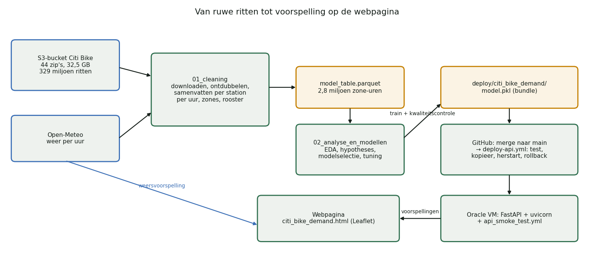

Het werk zit in twee notebooks, met alle code erin: elke functie staat in de sectie waar ze uitgelegd wordt. In de repository staat dezelfde code ook in `citibike.py`, voor het script `train.py` en de werknotebooks; de functie die de kenmerken berekent (`make_features`) staat bovendien in de API, en een test (`test_features.py`) controleert dat beide versies hetzelfde doen.

---

## 3. De data

### 3.1 Ritdata van Citi Bike
- **Bron:** de officiële publieke bucket `https://s3.amazonaws.com/tripdata/`, zonder login.
- **Inhoud:** één rij per rit: starttijd, eindtijd, start- en eindstation (naam, id, coördinaten), type gebruiker (member of casual), en sinds 2020 het fietstype (klassiek of elektrisch).
- **Omvang:** 44 NYC-bestanden (32,5 GB gezipt), juni 2013 – september 2026, samen **328,8 miljoen ritten**.
- **Opbouw:**
  - 2013–2023: één zip per jaar, met mappen of zip's per maand;
  - vanaf 2024: één zip per maand, met CSV-delen van ± 1 miljoen rijen.
- **Weggelaten:** 133 `JC-…`-bestanden. Dat is Jersey City, een apart systeem.

### 3.2 Weerdata van Open-Meteo
- **Wat:** Open-Meteo is een gratis weer-API zonder sleutel. Het **archief** gebruiken we voor de training, de **voorspelling** gebruikt de webpagina.
- **Variabelen per uur:** temperatuur, neerslag, wind, sneeuwval, luchtvochtigheid en **sneeuwhoogte** (cm sneeuw op de grond).
- **Eén punt voor heel NYC** (40,73° N, 73,97° W), in **lokale tijd**, zodat het klopt met de ritdata.
- **Zomertijd:** in maart ontbreekt één uur en in november komt één uur twee keer voor. We ontdubbelen en vullen dat ene uur in met interpolatie.

### 3.3 Waarom ritdata en weer volstaan, en wat ontbreekt
Uit de ritten weten we **wanneer** en **waar** er vertrokken werd. Het weer verklaart een groot deel van de schommelingen (zie §7). Wat niet in de data zit:
- evenementen (marathon, concerten);
- wegenwerken;
- hoeveel fietsen er in een station beschikbaar waren.

Die beperkingen komen terug in §11.

---

## 4. Cleaning: van 329 miljoen ritten naar een modeltabel

Het eindresultaat is één tabel met één rij per **zone** per **uur**: het aantal vertrekken, het weer, de kalender en het aantal actieve stations. In totaal 2.818.992 rijen (27,8 MB).

### 4.1 Downloaden met controle
- Een bestand wordt eerst naar `.part` geschreven en pas hernoemd als de grootte klopt. Een afgebroken download wordt zo nooit voor een geldige zip aangezien.
- Van elk bestand bewaren we een **SHA-256-checksum** in `manifest.json`: een vingerafdruk van het bestand. Iedereen kan zo controleren dat hij exact dezelfde data heeft.
- Wat er al volledig staat, wordt niet opnieuw gedownload.

### 4.2 Dubbele maanden in de jaarbestanden
De zip's van **2013** en **2018** bevatten elke maand twee keer: één keer als los bestand en één keer opgesplitst in een maandmap. Voor september 2013 bevatten beide versies exact **1.034.359** ritten, en elke rit (starttijd, start- en eindstation) komt in beide voor.

**Keuze:** per maand één versie houden. De functie `select_csvs` kiest de versie in de diepste map, zoals in alle andere jaren. Zo zijn 21 dubbele bestanden weggelaten. Zonder die stap zouden 2013 en 2018 dubbel tellen.

### 4.3 Drie generaties kolomnamen
We lazen de kolomnamen van alle 426 CSV's:

| Periode | Kolommen (begin) | CSV's |
|---|---|---|
| 2013–2019 | `tripduration, starttime, stoptime, start station id, …, usertype, birth year, gender` | 138 |
| sommige bestanden 2016–2017 | `Trip Duration, Start Time, Stop Time, …` | 8 |
| vanaf 2020 | `ride_id, rideable_type, started_at, ended_at, …, member_casual` | 280 |

**Keuze:** alles omzetten naar het schema van vandaag (`standardize_columns`):
- `starttime` en `Start Time` worden `started_at`;
- `usertype` wordt `member_casual` (*Subscriber* → member, *Customer* → casual);
- wat vroeger niet bestond, wordt leeg (`ride_id`) of `unknown` (`rideable_type`).

### 4.4 Drie datumnotaties
`2013-06-01 00:00:01` (ISO), `10/1/2014 00:00:27` en `1/1/2015 0:01`. In 2014–2016 wisselt de notatie zelfs van CSV tot CSV (2015: 4 CSV's zonder seconden, 12 met), maar binnen één CSV is ze vast.

**Keuze:** per stuk van 500.000 rijen de eerste notatie nemen die (bijna) alles kan lezen.
- **Waarom niet per rij laten raden?** Dat is tientallen keren trager en kan dag en maand verwisselen.
- **Bewijs dat het werkt:** in geen enkel jaar is er een rit met een onleesbare starttijd.

### 4.5 Samenvatten in stukken (chunking)
329 miljoen ritten passen niet in het geheugen van een laptop. Elk bestand wordt daarom in stukken van 500.000 rijen gelezen, en per stuk houden we alleen bij:
- het aantal vertrekken per station per uur;
- een stationslijst;
- een audit (wat er ontbreekt, wat werd weggelaten);
- een steekproef van 0,2% van de ritten.

Het resultaat wordt per bronbestand weggeschreven als **Parquet**, een compact kolomformaat. Een onderbroken run kan zo hervatten.

### 4.6 Wat telt als een vertrek?
| Vaststelling | Aantal | Keuze | Waarom |
|---|---|---|---|
| geen startstation (en bijna altijd ook geen locatie) | 92.077 (0,03%) | weg | geen zone te bepalen |
| geen eindstation | ± 0,2% per jaar | behouden | de fiets is wél vertrokken. Vanaf 2022 zijn het vooral e-bikes (57–93%, tegenover 39–72% van alle ritten) die niet in een station werden teruggezet, met een veel langere duur |
| startlocatie buiten NYC | 256 | weg | foute coördinaten |
| negatieve ritduur | 1.962, **alleen in november** | behouden | klokwissel: in november 2024 starten alle 319 zulke ritten op 3 november tussen 1u18 en 2u. Een rit van 1:50 (zomertijd) tot 1:10 (wintertijd) lijkt negatief |
| rit langer dan 24 uur | 157.541 | behouden | is nog altijd een vertrek |
| rit korter dan 1 minuut | 3 in de steekproef van 657.661 | behouden | Citi Bike haalt valse starts zelf al uit de data |
| "dubbele" rijen (2013–2017) | ± 56.000 (max. 0,4%, 2015) | behouden | geen ritnummer, soms tijd tot op de minuut: groepsritten zien er identiek uit. Vanaf 2020, met `ride_id`, zijn er 0 duplicaten |
| `ride_id` ontbreekt | alle 91,9 miljoen ritten vóór 2020 | niets | de kolom bestond toen niet; voor het tellen niet nodig |

**Waarom geen filter op ritduur?** Wij tellen **vertrekken**: elke rit telt één keer, hoe lang ze ook duurt. Bij een model dat de *ritduur* voorspelt, zou je extreme ritten wél moeten aanpakken. De ritduur is sterk rechtsscheef: mediaan ± 10 minuten, 99% korter dan 68 minuten, maar uitschieters tot een jaar.

Resultaat: **99,97%** van de ritten is bruikbaar als vertrek.

### 4.7 Station-id's
- **Kommagetal:** sommige CSV's bewaarden de id als getal. Daardoor werd `3423.10` → `3423.1` en `119` → `119.0`. In 2018–2019 gaat het om ± 40% van de ritten, daarna om hooguit enkele procenten. De functie `normalize_station_id` herstelt dat, afhankelijk van de periode (vóór of na februari 2021); in totaal 17,3 miljoen ritten.
- **Twee stelsels:** tot 2021 gehele getallen (`72`), daarna codes met een punt (`6926.01`). Hetzelfde station kreeg een nieuwe id.
- **Keuze:** stations zoveel mogelijk via hun **locatie** behandelen. Een station krijgt de zone van zijn coördinaten, en actieve stations tellen we als unieke locaties (op ± 10 m).
- **Wat overblijft:** 29 behouden id's hebben een ongewone vorm (0,05% van de vertrekken): varianten met een achtervoegsel (`5303.06_`, `…_Pillar`) en nieuwe id's die in 2019–2021 hun eindnul verloren (`7323.1`), toen beide systemen door elkaar liepen. Voor de zones maakt dat niets uit (zone = locatie); bij het tellen van actieve stations hooguit enkele dubbeltellingen per maand. We vermelden het als bekende kleine onvolkomenheid.
- **Bewijs:** als we id's tellen, staan in december 2019 **124 stations dubbel**. Enkele ritten in het bestand van 2020 begonnen in december 2019 en gebruiken al de nieuwe id.

### 4.8 Welke stations tellen mee?
Weggelaten: **interne locaties** (werkplaatsen, depots, laadkades, testlocaties zoals *Morgan Bike Mechanics*, *NYCBS Depot*, `Lab - NYC`) en stations van **Jersey City/Hoboken**. Samen zijn dat 110 id's en 18.813 vertrekken, minder dan 0,01%.

**Waarom:** een fiets die uit een werkplaats "vertrekt", is onderhoud of herverdeling, geen klantenvraag.

### 4.9 Categorische kolommen
`rideable_type` (klassiek / elektrisch) en `member_casual` worden het type `category`: minder geheugen, en duidelijk dat het geen vrije tekst is. Ze zijn **geen kenmerk** voor het model (bij een voorspelling weet je niet wie er zal fietsen), maar we tellen per zone-uur wel hoeveel vertrekken van members en met e-bikes waren, om het gedrag te begrijpen: e-bikes van 0% (vóór 2020) naar ± 72%, members zakten tijdens corona van 87% naar 73%.

### 4.10 Het weer: volledig?
Het weer van Open-Meteo is volledig: alle 116.880 uren van juni 2013 tot september 2026, zonder ontbrekende waarden of dubbele uren (na de correctie voor de zomertijd).

### 4.11 Dagen waarop het systeem dicht was, en ontbrekende data
We vergelijken elke dag met de mediaan van de 4 weken eromheen. **12 dagen** liggen onder 3% van normaal: allemaal sneeuwstormen waarop Citi Bike het systeem stillegde (o.a. 23–26 januari 2016, 14–16 maart 2017, 1–2 februari 2021, 23 februari 2026).

**Keuze:** die dagen weglaten.
- **Waarom:** er was geen aanbod, dus "0 vertrekken" zegt niets over de vraag.
- **Wat blijft:** echt rustige dagen (zware regen, sneeuw, Kerstmis). Die moet het model wél leren.

**Ontbreken er bestanden of maanden?** Nee: elke maand is aanwezig, en de enige dagen zonder ritten zijn de gesloten dagen. Maanden die veel lager liggen dan een jaar eerder (februari 2026: −40%, februari 2021: −45%) zijn echte lage vraag door sneeuw en sluitingen, geen gaten.

### 4.12 Zones, aanbod, rooster, weer en split
| Stap | Keuze | Waarom |
|---|---|---|
| zones | 30 zones met KMeans (§5) op het netwerk van de laatste 12 maanden | per station is er te veel toeval; het model voorspelt de stad van vandaag |
| actieve stations | aantal unieke locaties met ≥ 1 vertrek per zone per maand = **kenmerk** | het netwerk groeide van 330 naar ± 2.400 stations |
| zone-uren zonder aanbod | weg | in 2014 was er in de Bronx geen vraag te meten, niet "0 vraag" |
| rooster | elke zone × elk uur, uren zonder vertrek = 0 | anders leert het model alleen van uren met vraag en overschat het |
| weer | per uur erbij, inclusief sneeuwhoogte | belangrijkste factor buiten de kalender (§7) |
| split | test = laatste 12 maanden | meten zoals het model gebruikt wordt (§8) |

**Controle:** de som van alle vertrekken in de tabel is exact gelijk aan alle vertrekken van de publieke stations, buiten de 12 gesloten dagen. Er gaat niets verloren.

### 4.13 Is de data verbeterd?
| | Ruw | Na cleaning |
|---|---|---|
| rijen | 328.800.493 ritten | 2.818.992 zone-uren (incl. 0) |
| kolomschema's / datumnotaties | 3 / 3 | 1 / 1 |
| dubbele CSV-versies | 21 | 0 |
| ritten zonder startlocatie | 92.077 | 0 |
| station-id's als getal opgeslagen | 17.320.781 | 0 |
| vertrekken van interne/JC-HB-stations | 18.813 | 0 |
| gesloten dagen | 12 | 0 |
| uren zonder vertrek | ontbreken | 117.517 (als 0) |
| weer | niet aanwezig | elk uur, 6 variabelen |

### 4.14 Dezelfde stappen voor de studie op 2024
De modelselectie (§9) gebeurt eerst op één jaar, 2024. Notebook 1 maakt daarvoor een aparte tabel met dezelfde cleaning, maar met zones gefit op de stations **van 2024**, zonder `year` en `active_stations` (geen groei binnen één jaar), en met als testset **de laatste 7 dagen van elke maand** (§8.2). Resultaat: 263.520 zone-uren (30 zones × 8.784 uren), 44,3 miljoen vertrekken, 0,3% zonder vertrek.

---

## 5. Unsupervised learning: KMeans

**KMeans** verdeelt punten in *k* groepen, zodat elk punt zo dicht mogelijk bij het centrum van zijn groep ligt. Het algoritme kiest centra, wijst elk punt toe aan het dichtstbijzijnde centrum, verplaatst de centra naar het gemiddelde van hun punten, en herhaalt dat tot er niets meer verandert. Het is *unsupervised*: er is geen "juist antwoord", het algoritme zoekt zelf structuur.

We gebruikten KMeans twee keer.

### 5.1 Zones: stations groeperen op locatie
- **Invoer:** de coördinaten van de stations, omgerekend naar km (zodat noord-zuid en oost-west even zwaar wegen).
- **Gewogen met het aantal ritten** (`sample_weight`): de centra komen dichter bij elkaar waar veel gefietst wordt. Drukke buurten krijgen zo kleinere zones.
- **Op het netwerk van de laatste 12 maanden** (2.433 stations): het model voorspelt de toekomst.

**Hoeveel zones?**

| k | silhouette | mediaan vertrekken per zone-uur | rustigste zone |
|---|---|---|---|
| 5 | 0,35 | 892 | 383 |
| 10 | 0,35 | 397 | 163 |
| 20 | 0,34 | 229 | 35 |
| **30** | **0,32** | **150** | **32** |
| 40 | 0,35 | 101 | 19 |
| 50 | 0,34 | 92 | 11 |
| 75 | 0,32 | 60 | 11 |

- **Inertia:** de totale (gekwadrateerde) afstand van de punten tot hun centrum. Ze daalt steil tot ± 20 à 30 zones en daarna nog maar langzaam (de "elleboog").
- **Silhouette:** meet hoe goed een punt bij zijn eigen groep past in vergelijking met de buurgroep (−1 tot 1). Hier is ze voor elke k ongeveer gelijk: de stad is één doorlopend netwerk zonder natuurlijke grenzen. Ze helpt dus niet bij de keuze.
- **De doorslag:** met 30 zones heeft zelfs de rustigste zone nog ± 32 vertrekken per uur. Bij meer zones domineert het toeval.

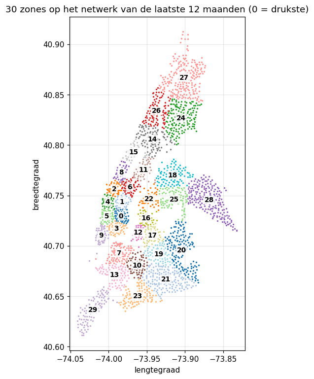

### 5.2 Stationsprofielen: stations groeperen op gedrag
- **Invoer:** per station het **aandeel** van zijn vertrekken per uur, apart voor weekdagen en weekend (48 getallen die samen 1 zijn). Zo vergelijken we de vorm van het dagpatroon, los van hoe druk een station is.
- **Stations:** de ± 2.000 stations met minstens 2.000 vertrekken in 2024 (anders is het profiel te ruizig).
- **Hoeveel profielen?** De inertia daalt het sterkst tot 4 clusters; met 4 krijgen we profielen die je ook kan benoemen.
- **Resultaat:** vier soorten stations, zonder dat we het model iets over buurten vertelden.

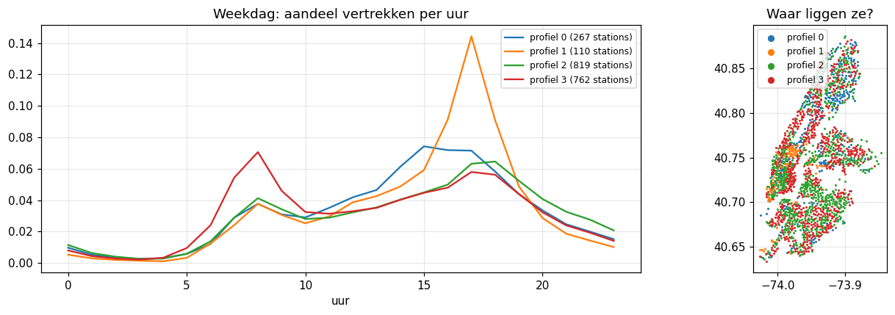

| Profiel | Patroon | Waar |
|---|---|---|
| woonbuurt | piek om **8u** (vertrek van thuis) | Upper East/West Side, Brooklyn, Queens |
| kantoorwijk | enorme piek om **17u**, bijna geen ochtendpiek | Midtown, Financial District |
| piek rond 15u | einde van de schooldag | Harlem, de Bronx |
| gemengd | veel avondritten | Lower Manhattan, Williamsburg |

**Wat het ons leerde:** het dagritme hangt af van de plaats. Het model heeft dus de **interactie** zone × uur × weekdag/weekend nodig. Het verklaart ook waarom herverdeling nodig is.

---

## 6. EDA: wat bepaalt de vraag?

### 6.1 Groei over 13 jaar
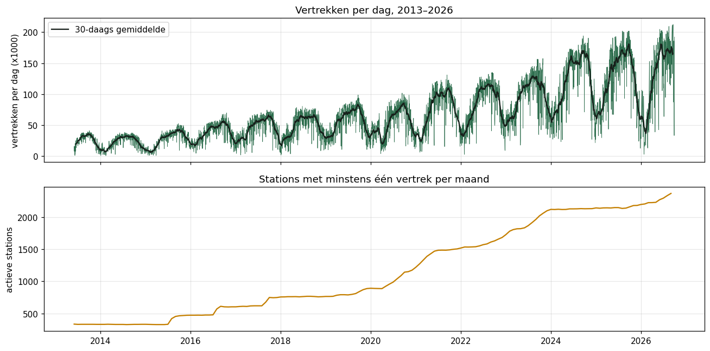

- **Vraag:** van ± 35.000 vertrekken per dag (zomer 2013) naar ± 170.000 (zomer 2025–2026).
- **Netwerk:** groeit in sprongen, van 330 naar ± 2.400 stations.
- **Corona** (voorjaar 2020): een korte dip, daarna de snelste groei ooit. Het aandeel casual riders steeg van 14% naar 27%, en het aandeel e-bikes van 0% (vóór 2020) naar 73%.
- **Gevolg:** het model krijgt het **jaar** en het **aantal actieve stations** als kenmerk.

### 6.2 Seizoen en temperatuur
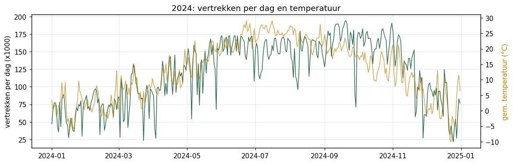

- **Samenhang met temperatuur:** het dagtotaal volgt de temperatuur (Spearman ρ = 0,77). *Spearman* meet of twee reeksen samen stijgen en dalen, ook als het verband niet lineair is.
- **Dalen:** de diepste dalen zijn regendagen.
- **Piek:** in september–oktober, als forenzen en studenten terug zijn.

### 6.3 Dagritme
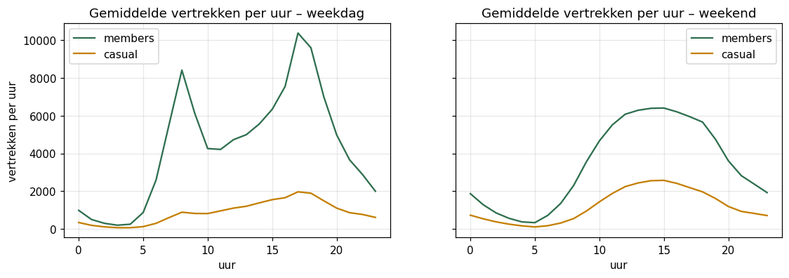

- **Weekdagen:** twee spitsen (8u en 17u), vooral bij members. Casual riders fietsen vooral in de namiddag.
- **Weekend:** één brede bult van 10u tot 19u.
- **Regen:** bij hetzelfde uur en daltype ligt de curve bij regen (≥ 0,5 mm/u) duidelijk lager: op weekdagen ± een derde, in het weekend meer dan de helft. Vrijetijdsfietsen is gevoeliger voor regen dan woon-werkverkeer.
- **Gevolg:** het model moet uur en weekdag/weekend **combineren**, en het weer kennen.

### 6.4 De target
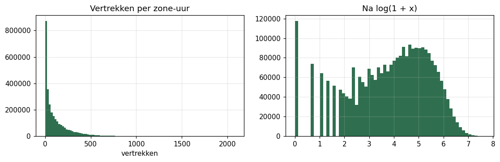

- **Wat voor variabele:** een **telling** (0, 1, 2, …), rechtsscheef.
- **Nullen:** in 2024 heeft maar 0,3% van de zone-uren 0 vertrekken, over alle jaren 4% (de kleine netwerken van de eerste jaren). Ze expliciet als 0 opnemen is dus correct.
- **Overdispersie:** de variantie is veel groter dan het gemiddelde (gemiddeld 117, variantie ± 23.600). Bij een zuivere Poisson-verdeling zijn die gelijk; hier verschilt de verwachting sterk per zone en uur.
- **Gevolg:** we gebruiken modellen met een **Poisson-verliesfunctie** (§9.1).

---

## 7. Statistiek: de hypotheses

Vóór het modelleren toetsten we of er een **echt** patroon is, en of het **groot genoeg** is om ertoe te doen. Significantieniveau α = 0,05.

### 7.1 H1: regen verlaagt de vraag
- H₀: neerslag verandert het aantal vertrekken niet.
- H₁: in natte uren vertrekken er minder fietsen (eenzijdige toets).

**Probleem: confounding.** Regen valt niet willekeurig, bijvoorbeeld vaker in bepaalde maanden of uren. Vergelijk je zomaar natte met droge uren, dan meet je deels "winter tegen zomer".

**Oplossing: stratificeren.** We vergelijken alleen uren met hetzelfde uur, daltype en dezelfde maand. Dat geeft 328 strata.

**Toets 1: Wilcoxon signed-rank.**
- **Wat de toets doet:** een niet-parametrische toets voor gepaarde metingen. Hij rangschikt de verschillen (hier: log(nat/droog) per stratum) en kijkt of er systematisch meer negatieve dan positieve zijn. Er is geen normale verdeling nodig.
- **Resultaat:** in 95% van de strata minder vertrekken bij regen; mediaan nat/droog 0,53; p ≈ 5·10⁻⁵⁴.

**Toets 2: Poisson-regressie met vaste effecten.**
- **Het model:** `log(vraag) = effect(dag) + effect(uur × daltype) + β · nat`. Door een apart effect per **kalenderdag** vergelijken we een nat uur met droge uren van dezelfde dag.
- **Robuuste standaardfouten, geclusterd per dag:** uren van dezelfde dag hangen samen. Gewone standaardfouten zouden dan te klein zijn, en de p-waarde te optimistisch.
- **Technisch detail:** het daltype zit al in het dag-effect (elke dag is een weekdag of een weekenddag). Daarom coderen we het uur apart binnen weekdagen en binnen weekenddagen, anders is het model niet eenduidig bepaald.
- **Resultaat:** een nat uur kost **27%** van de vertrekken (95%-BI −32% tot −21%).
- **Waarom −27% en niet −47% zoals in toets 1?** Toets 1 vergelijkt met droge uren van *andere* dagen en meet dus ook "het is een regendag" (wie 's ochtends regen ziet, laat de fiets de hele dag staan). Toets 2 meet alleen het effect van dit ene natte uur.
- **Dosis-effect:** ≤ 0,5 mm −11%, 0,5–2 mm −25%, 2–5 mm −34%; boven 5 mm −21%, maar dat zijn maar 42 uren met een breed interval (korte onweersbuien). Het effect is dus niet lineair in de hoeveelheid regen.

### 7.2 H2: weekdagen hebben een ander dagritme dan het weekend
**Chi-kwadraattoets op homogeniteit:** we vergelijken de verdeling over 24 uren tussen weekdagen en weekend. Met 44 miljoen ritten is p ≈ 0, dus we kijken vooral naar de effectgrootte.
- **Cramér's V** = 0,20: de sterkte van het verband (0 = geen, 1 = volledig), hier klein tot middelmatig.
- **Strenger, met de dag als eenheid:** het aandeel van de ochtendspits (7–9u) is op weekdagen 17,9% en in het weekend 8,3%.
- **Mann–Whitney U-toets:** een niet-parametrische vergelijking van twee onafhankelijke groepen (262 weekdagen tegen 104 weekenddagen). Resultaat: p ≈ 10⁻⁴⁵. Het verschil van 9,7 procentpunt heeft een bootstrap-interval van 9,2 tot 10,3.

### 7.3 Hoeveel verklaren kalender en weer samen?
Twee eenvoudige Poisson-modellen op het stadstotaal per uur. De maat is het aandeel van de **deviance** dat het model verklaart (zoals R², maar voor tellingen):
- alleen *uur × daltype + maand*: **89%**;
- met het weer erbij: **92,5%**.

De kalender bepaalt het grootste deel, maar het weer maakt het verschil tussen een gewone en een "slechte" dag: precies de dagen waarop een planner het model nodig heeft.

### 7.4 p-waarde en effectgrootte
De **p-waarde** zegt hoe verrassend het resultaat is als H₀ waar zou zijn. Met miljoenen rijen wordt elk verschil "significant". De **effectgrootte** (−27%, Cramér's V, het verschil in procentpunt) zegt of het verschil ertoe doet. Daarom rapporteren we altijd beide, samen met een **betrouwbaarheidsinterval** (BI): het bereik waarin het echte effect met 95% zekerheid ligt.

---

## 8. Hoe we modellen eerlijk meten

### 8.1 Train, validatie en test
- **Trainset:** hierop leert het model.
- **Validatie:** hiermee kiezen en tunen we het model.
- **Testset:** eenmalige eindmeting. Wie de testset gebruikt om te kiezen, meet te optimistisch.

### 8.2 Studie op 2024: GroupKFold op kalenderweken
- **Test:** de laatste 7 dagen van elke maand, zodat elk seizoen erin zit.
- **Validatie:** `GroupKFold(5)` met de **kalenderweek** als groep.
- **Waarom groeperen?** Naburige uren lijken sterk op elkaar (**autocorrelatie**). Als 8u in de training zit en 9u in de validatie, ziet het model bijna het antwoord: dat is **data leakage**. Met hele weken als groep kan dat niet.

### 8.3 Studie op alle data: backtesting
Met 13 jaar is er een sterke **trend**. Willekeurige weken zouden het model voor 2019 laten leren van 2020. Daarom gebruiken we **backtesting** (AWS-hoofdstuk 4): altijd trainen op het verleden en valideren op de toekomst.

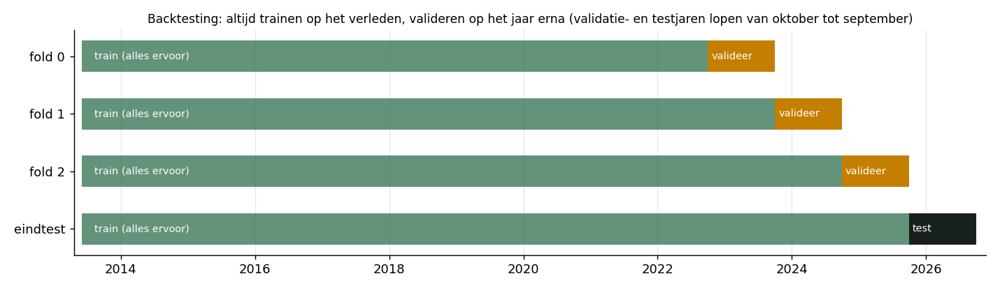

### 8.4 Metrics
| Metric | Wat | Waarom |
|---|---|---|
| **MAE** (mean absolute error) | gemiddelde absolute fout: "x vertrekken per uur ernaast" | primaire metric, uit te leggen aan een planner |
| **RMSE** | wortel van de gemiddelde gekwadrateerde fout | straft grote missers zwaarder (een gemiste spits) |
| **R²** | aandeel van de variatie dat het model verklaart | algemeen beeld (1 = perfect) |
| **Poisson-deviance** | foutmaat voor tellingen: een fout van 5 bij verwachting 2 weegt zwaarder dan bij verwachting 200 | past bij de target |
| **relatieve MAE** | MAE / gemiddelde vraag | vergelijken tussen testsets met een ander niveau |

### 8.5 Is een verschil echt? Gepaarde block bootstrap
Twee modellen die 0,5 verschillen in MAE kunnen even goed zijn. We **hertrekken** daarom 2.000 keer hele **testdagen** (met teruglegging) en berekenen telkens het verschil in MAE. Zo krijgen we een 95%-interval voor de winst.
- **Waarom hele dagen** (*block* bootstrap)? Uren van dezelfde dag hangen samen (dezelfde regen, dezelfde feestdag). Losse uren hertrekken zou het interval te smal maken.
- **Waarom gepaard?** Beide modellen worden op exact dezelfde getrokken dagen gemeten.

Daarnaast kijken we per **fold**: wint het model in elke fold, of alleen gemiddeld?

---

## 9. De modellen

### 9.1 Poisson-verlies
Bij een gewone regressie minimaliseer je de gekwadrateerde fout. Bij **Poisson-verlies** minimaliseer je de Poisson-deviance, en het model voorspelt `log(verwachting)`. Gevolgen:
- voorspellingen zijn altijd > 0;
- effecten worden **vermenigvuldigend**: regen haalt er 30% af in plaats van 5 vertrekken. Dat past bij tellingen die per zone sterk verschillen.

### 9.2 Modelselectie op 2024
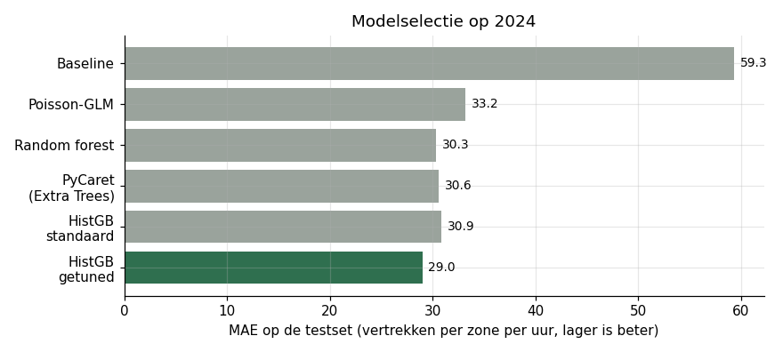

#### Baseline: gemiddelde per zone × uur × weekend
- **Wat:** voorspel het gemiddelde uit de trainset voor dezelfde combinatie.
- **Waarom:** een model is pas nuttig als het beter doet dan wat een planner in Excel zou doen.
- **Resultaat:** MAE 59,3, R² 0,72. Globaal gemiddelde 138, per zone 117: het dagritme per plaats is de grootste informatiebron. De fout verschilt per fold (52 tot 70): daarom vergelijken we modellen altijd op dezelfde folds.

#### Snel eerste model: gradient boosting met standaardinstellingen
- **Wat:** hetzelfde type model dat uiteindelijk won (zie verder), zonder te tunen.
- **Waarom:** zo kon de deployment (API en webpagina) al gebouwd worden terwijl we verder tunden.
- **Resultaat:** MAE 30,9 (CV 27,6), R² 0,90: de fout halveert opnieuw tegenover de baseline, in elke fold.

#### Poisson-GLM (generalized linear model)
- **Wat:** `log(vraag) = som van effecten`, met:
  - **one-hot encoding** van zone × uur × weekend (1.440 kolommen) plus maand en feestdag. Eén kolom per categorie, omdat categorieën geen getallen zijn;
  - een **spline** voor de temperatuur: een gebogen curve opgebouwd uit stukjes polynoom;
  - `log(1 + neerslag)`;
  - **L2-regularisatie** (`alpha`): een straf op grote coëfficiënten.
- **Waarom:** uitlegbaar. Elk effect is een factor.
- **Additief of met interactie?** Een lineair model vindt geen interacties zelf. Zonder de interactie zone × uur × weekend: CV-MAE 37,3; mét: 30,5, in elke fold. Dat bevestigt de stationsprofielen (§5.2).
- **Regularisatie (grid search):** `alpha` van 10⁻⁶ tot 10⁻² geprobeerd. Tot 10⁻⁴ maakt het niets uit (30,45), bij 10⁻² wordt het slechter (34,5): met 200.000 rijen en ± 1.500 coëfficiënten is er weinig risico op overfitting.
- **Resultaat:** MAE 33,2. Wat het model leerde:
  - regen: −30% per mm/u;
  - feestdag: −17%;
  - oktober: 1,7 keer januari bij dezelfde temperatuur;
  - temperatuur: optimum rond 29 °C (grafiek hieronder).
- **Waarom niet verder:** het mist interacties die we niet zelf bouwden, en `log1p` dwingt een steeds groter regeneffect af. Het blijft nuttig voor de **uitleg**.

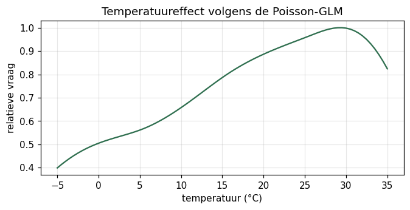

#### Random forest
- **Wat:** honderden diepe beslissingsbomen, elk getraind op een **bootstrap-steekproef** van de rijen en met een willekeurige subset van kenmerken per split. Het gemiddelde van de bomen is de voorspelling (**bagging**: de variantie van één boom wordt uitgemiddeld).
- **Hyperparameters:**
  - `min_samples_leaf`: minimum rijen per blad;
  - `max_features`: aandeel kenmerken per split;
  - `max_depth`: maximale diepte;
  - `max_samples`: grootte van de steekproef per boom.
- **Zone als getal:** de random forest van scikit-learn kent geen categorieën. De zones zijn genummerd van druk naar rustig, dus een split "zone ≤ 5" is toch zinvol.
- **Twee zoekrondes (randomized search):**
  - ronde 1, breed (grote bladeren, 30–100% van de kenmerken per split): beste CV-MAE 30,9, **slechter** dan de standaard (28,1). De standaard gebruikt álle kenmerken en bladeren van 1 uur, en precies dat gebied lag buiten de zoekruimte. De slechtste combinaties gebruikten maar 30% van de kenmerken per split (MAE 42): met 9 kenmerken, waarvan uur, zone en temperatuur het meeste werk doen, is een split zonder uur of zone vaak slecht;
  - ronde 2, rond de standaard: CV-MAE 27,4, in elke fold beter dan de standaard. De echte verbetering: iets kleinere bootstrap-steekproeven per boom (± 72%), wat de bomen diverser maakt.
- **Resultaat:** MAE 30,3, R² 0,90.
- **Impurity importance** (ingebouwd in bomen): uur 40%, zone 34%, temperatuur 14%, neerslag maar 2%. Dat laatste is misleidend: het regent zelden, en deze maat telt hoeveel een kenmerk *gemiddeld over alle splits* helpt. Daarom meten we ook met permutation importance (§11.3).
- **Waarom niet verder:** minder goed dan boosting, en 300 diepe bomen met bladeren van 1 uur geven een groot, traag model.

#### PyCaret (AutoML)
- **Wat:** probeert automatisch een reeks modellen met dezelfde split en dezelfde week-folds (`fold_strategy="groupkfold"`) en tunet de beste drie (`tune_model`, 15 combinaties, `choose_better=True`).
- **Waarom:** een onafhankelijke controle van onze eigen keuzes.
- **Welke modellen:** boosting (LightGBM, XGBoost, GradientBoosting), bagging (random forest, Extra Trees), één beslissingsboom, lineaire modellen en een dummy. **Niet**: kernelmethodes (SVM, kernel ridge), Gaussian process en k-nearest neighbours, die kwadratisch of per voorspelling over alle trainrijen schalen, en varianten van lineaire regressie die niets toevoegen.
- **Resultaat:**
  - beste model Extra Trees (*extremely randomized trees*: random forest met willekeurige splitpunten): CV 27,0 → getuned 26,6, test MAE 30,6;
  - random forest 28,1 → 27,5, LightGBM 30,7 → 29,4, XGBoost 31,2;
  - lineaire modellen ± 97 (R² 0,46), omdat ze de ruwe kolommen krijgen: het uur als één getal, zonder interacties. Ons eigen GLM haalde 30,5: het verschil is volledig **feature engineering**.
- **Waarom doet onze gradient boosting het beter dan LightGBM?** Poisson-verlies, de zone als echte categorie, en meer bomen met een kleinere learning rate.
- **Waarom niet verder:** het vond geen beter model, maar bevestigde de keuze voor bomen.

#### Gradient boosting (gekozen)
- **Wat:** bomen **na elkaar**, waarbij elke nieuwe kleine boom de fouten van alle vorige samen leert (**boosting**). De **histogram**-variant deelt elke kolom eerst in maximaal 255 bakjes in, wat snel is op miljoenen rijen.
- **Belangrijke hyperparameters:**
  - `learning_rate`: hoe groot elke correctiestap is;
  - `max_iter`: aantal bomen;
  - `max_leaf_nodes`: grootte van een boom;
  - `min_samples_leaf`: minimum rijen per blad;
  - `l2_regularization`: straf op grote bladwaarden;
  - `categorical_features`: de zone als echte categorie;
  - bij veel data stopt het model vanzelf als extra bomen niet meer helpen op 10% interne validatie (**early stopping**).
- **Tuning:** randomized search, 25 combinaties × 5 folds. De beste combinaties delen een kleine learning rate (0,02–0,07) en grote bomen (75–125 bladeren); de slechtste hebben een grote learning rate (te grote stappen) of kleine bomen (te weinig ruimte voor interacties). De top 8 ligt binnen 0,4 van elkaar, minder dan de spreiding over de folds.
- **Resultaat:**
  - standaard: MAE 30,9 (CV 27,6);
  - **getuned: MAE 29,0 (CV 24,9), R² 0,906**, in alle 5 folds beter dan de standaard;
  - beter dan elk ander model in **alle 5 folds**. Bootstrap tegenover random forest: +1,3 (95%-BI 0,2 tot 2,5), tegenover PyCaret +1,5 (0,3 tot 3,0).
- **Waarom gekozen:** de beste fout, een klein model (5–7 MB), en alleen scikit-learn nodig op de server.

#### Experiment: lags
- **Wat:** het aantal vertrekken 24 uur en 168 uur eerder als kenmerk. Tijdreeksen hebben autocorrelatie.
- **Resultaat:** op de testset beter (26,9 tegenover 29,0), maar in de cross-validatie slechter (27,5 tegenover 24,9), en in **geen enkele** van de 5 folds beter.
- **Waarom niet verder:** de winst is niet betrouwbaar (een **misleidende testverbetering**). Bovendien kent een gebruiker op de webpagina de vertrekken van gisteren niet; daarvoor zou de API een live koppeling met Citi Bike nodig hebben.

#### Foutenanalyse van het 2024-model
- **Per uur:** absoluut de grootste fout in de spits; relatief 's nachts (25–38% van een handvol ritten: toeval). Overdag is het weekend relatief moeilijker (20–25%) dan een weekdag (14–18%).
- **Per zone:** overal ± 19–20% van de vraag, alleen de rustigste zone hoger (25%). Het model overschat in elke zone een beetje, door de dagen hieronder.
- **Per dag:** de grootste fouten zijn **Kerstmis** (+213%), **Thanksgiving** (+165%) en de dagen errond, en Memorial Day (+72%, met 45 mm regen). Het model had in zijn ene trainingsjaar geen enkel voorbeeld van die dagen gezien. Dat werd de aanleiding voor §10.
- **Regen:** het model onderschat het regen-effect (bij 0,5–2 mm/u: 106 voorspeld, 90 werkelijk).
- **Permutation importance:** uur (+98) en zone (+82), dan temperatuur, weekdag, maand; wind en weekend ≈ 0 (weekend zit al in de weekdag).

### 9.3 Tuning
- **RandomizedSearchCV:** probeert willekeurige combinaties uit een zoekruimte, bijvoorbeeld 25 combinaties × 5 folds. Dat is efficiënter dan alle combinaties proberen.
- **GridSearchCV:** probeert alle waarden van een rooster. Dat deden we voor `alpha` van het GLM.
- **Standaard of getuned?** We vergelijken altijd de getunede instellingen met de standaard op exact dezelfde folds, en houden de beste (zoals PyCaret's `choose_better=True`).
- **Lessen:**
  - een zoekruimte moet de standaardinstellingen bevatten (§13);
  - als de verschillen tussen de beste combinaties kleiner zijn dan de spreiding over de folds, maakt de exacte keuze weinig uit.
- **In het notebook:** elke zoektocht bewaart zijn volledige resultaat in `models/searches/`. Met `RUN_SEARCHES = False` gebruikt notebook 2 die bewaarde resultaten (of voert het de zoektocht uit als ze nog niet bestaan); met `True` doet het alles opnieuw (enkele uren).

---

## 10. Van 2024 naar alle data

### 10.1 Waarom
Het 2024-model maakte de grootste fouten op **Kerstmis** (+213%) en **Thanksgiving** (+165%). Die dagen zaten in de testweken, en in zijn ene trainingsjaar had het model er geen enkel voorbeeld van. Met 13 jaar data heeft het er telkens een tiental.

### 10.2 Wat er veranderde
- **Nieuwe kenmerken:** `year` (trend), `active_stations` (aanbod in de zone) en `snow_depth_cm` (§10.5).
- **Validatie:** backtesting (§8.3); test = de laatste 12 maanden.
- **Baselines op alle data:** het gemiddelde per zone × uur × weekend over **alle jaren** haalt 82 (backtest), over **de laatste 12 maanden** 58: een gemiddelde over 13 jaar onderschat de vraag van vandaag. Op de testset haalt de beste baseline 71 (R² 0,68): nieuwe stations en een koude winter.
- **Standaardinstellingen** volstaan niet meer (backtest 36,4, test 36,1): hooguit 100 bomen, te weinig voor 2,5 miljoen rijen. Met de **instellingen uit 2024**: backtest 32,0, test 29,1 (de eerste versie in de API).
- **Hertunen** op alle data: 10 combinaties × 3 backtest-folds. De beste instellingen hebben veel grotere bladeren (± 335 uren in plaats van 18): met ± 10 keer meer trainingsdata kan elk blad op meer uren steunen. De winst was klein (backtest 32,0 → 31,8, wel in alle drie de folds); test **28,9**.
- **Fold 1 is moeilijker** (38,5 tegenover ± 28): in dat validatiejaar (oktober 2023 – september 2024) groeide het netwerk het snelst, en elke fold leert alleen van de jaren ervoor.

### 10.3 Helpt meer data echt? De leercurve
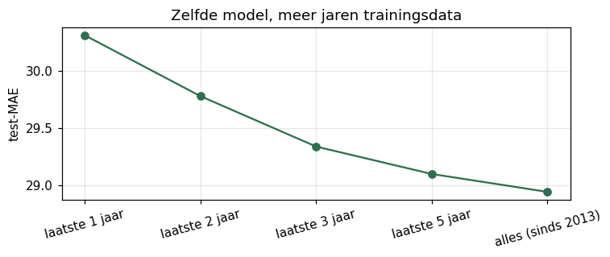

Hetzelfde model, getraind op steeds meer jaren, gemeten op dezelfde testset:

| Trainingsdata | 1 jaar | 2 jaar | 3 jaar | 5 jaar | alles |
|---|---|---|---|---|---|
| test-MAE | 30,3 | 29,8 | 29,3 | 29,1 | **28,9** |

Ja, meer data helpt, met **afnemende meeropbrengst**. De oudste jaren voegen weinig toe, maar schaden ook niet.

### 10.4 Helpen de nieuwe kenmerken? Ablatie
Bij een **ablatie** laat je één onderdeel weg en meet je opnieuw. Wat dan verslechtert, was belangrijk.

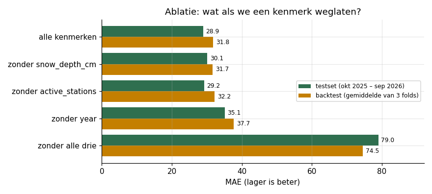

- **Zonder alle drie** (de kenmerken uit 2024) is het model onbruikbaar op alle data: MAE 79, R² 0,60. Het middelt 13 jaar groei uit.
- **`year`** is onmisbaar.
- **`active_stations`** helpt weinig, maar in elke fold.
- **`snow_depth_cm`:** zie hieronder.

### 10.5 Een iteratie door de foutenanalyse: sneeuw op de grond
In een eerste versie van de foutenanalyse zaten de grootste fouten op **droge dagen ná een sneeuwstorm**. Op 26 januari 2026 voorspelde het model 9 keer te veel: het kende alleen de neerslag van het uur zelf en wist niet dat er nog 26 cm sneeuw lag. Daarom voegden we de **sneeuwhoogte** toe.

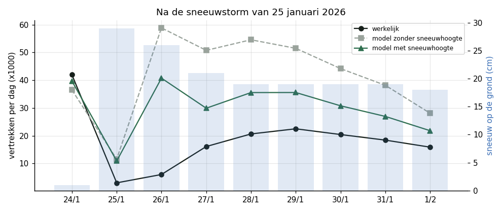

- **Op de testset:** MAE 30,1 → 28,9, en de fouten na de storm halveren ruwweg.
- **In de backtest:** neutraal (31,7 zonder, 31,8 met; beter in 2 van de 3 folds). Waarom? Vergelijk de winters (december–februari):

| Winter | Rol | Gem. temperatuur | Dagen met ≥ 5 cm sneeuw op de grond | Max. sneeuwhoogte |
|---|---|---|---|---|
| 2013–2014 | training | −1,6 °C | 54 | 47 cm |
| 2014–2015 | training | −1,9 °C | 36 | 35 cm |
| 2020–2021 | training | 0,9 °C | 34 | 30 cm |
| 2022–2023 | validatie | 3,4 °C | 1 | 7 cm |
| 2023–2024 | validatie | 2,8 °C | 22 | 14 cm |
| 2024–2025 | validatie | 0,1 °C | 9 | 10 cm |
| **2025–2026** | **test** | **−1,9 °C** | **41** | **51 cm** |

  De validatiewinters hadden weinig sneeuw; de testwinter was samen met 2014–2015 de koudste en had de grootste sneeuwhoogte van alle jaren. Het kenmerk helpt alleen als er sneeuw ligt, dus in de backtest kon het zijn waarde nauwelijks tonen. Dat de trainingsjaren wél sneeuwwinters bevatten, is ook waarom het model op alle data in januari en februari 2026 het meest beter is dan het model op één jaar.
- **We houden het, met die kanttekening.** Het verschil met de lags: die waren in **elke** fold slechter, de sneeuwhoogte is in de backtest neutraal, en het mechanisme is logisch.

---

## 11. Foutenanalyse

**Het definitieve model tegenover hetzelfde model op één jaar:** +1,4 vertrekken per uur beter (95%-BI 0,7 tot 2,1), in bijna elke maand, en het meest in de sneeuwmaanden.

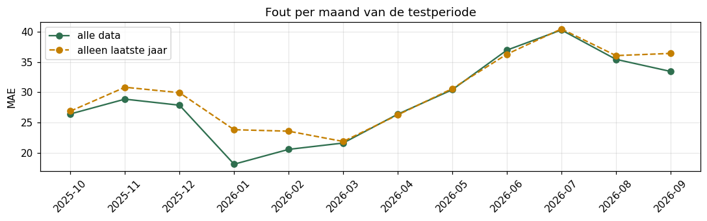

### 11.1 Feestdagen: de zwakke plek uit 2024
Fout van de voorspelde vertrekken per dag (alle zones samen), voor elke officiële feestdag in de testperiode:

| Dag | Definitief model | Zelfde model, 1 jaar data | 2024-studie |
|---|---|---|---|
| Thanksgiving | **+5%** | −22% | +165% |
| Kerstmis | **+26%** | +38% | +213% |
| Nieuwjaar | −4% | +11% | |
| Martin Luther King Day | −16% | −25% | |
| Presidents Day | +20% | +1% | |
| Memorial Day | +11% | +13% | +72% |
| Juneteenth | −9% | −21% | |
| 4 juli (gevierd op 3 juli) | +23% | +17% | |
| Labor Day | −7% | −13% | |
| **Columbus Day** | **+41%** (regendag) | +66% | |
| **Veterans Day** | **−52%** | −63% | |

**Wat nog misgaat:**
- **Columbus Day** en **Veterans Day**: op die dagen werken veel New Yorkers gewoon, maar het model leerde één effect voor alle feestdagen samen. Eén vlag `is_holiday` is te grof;
- de dagen **rond** de feestdagen: de dag na Thanksgiving +68%, kerstavond +103%, de week tot Nieuwjaar +33% tot +197%. Dat zijn geen officiële feestdagen, dus het model verwacht gewone werkdagen.

### 11.2 Andere fouten
- **Vlak na zware sneeuw** blijft het model te optimistisch: het weet niet of de straten geruimd zijn.
- **Bij zware regen** (> 2 mm/u) overschat het model nog: 102 voorspeld, 77 werkelijk.
- **In snelgroeiende zones** (de Bronx, Queens) onderschat het model: nieuwe stations worden steeds beter gebruikt, en het model volgt dat met vertraging.
- **Relatief** is de nacht het moeilijkst (weinig ritten, veel toeval); **absoluut** de spits.

### 11.3 Permutation importance
- **Wat:** we husselen één kolom van de testset door elkaar en meten hoeveel de MAE stijgt. Een kenmerk waar het model niets mee doet, kost niets.
- **Waarom deze methode:** eerlijker dan de *impurity importance* van bomen, die kenmerken met veel waarden bevoordeelt en zeldzame maar sterke kenmerken (regen) onderschat.
- **Resultaat:** uur (+102) en zone (+94) zijn veruit het belangrijkst, dan temperatuur (+39) en weekdag (+20).
- **Opvallend:** `year` scoort **0**, terwijl het model zonder `year` veel slechter is. Geen tegenspraak: binnen de testset is het jaar bijna overal 2025 of 2026, dus husselen verandert niets. `year` is nodig om bij het **trainen** de jaren uit elkaar te houden.

---

## 12. Deployment

### 12.1 Architectuur
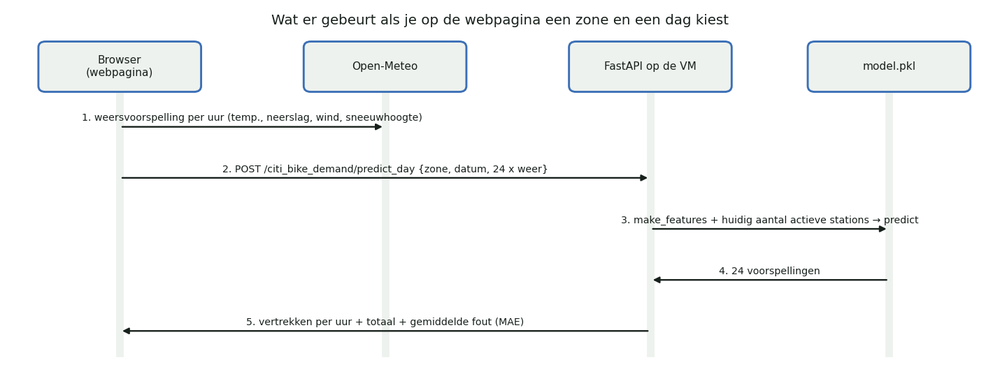

### 12.2 Onderdelen
| Onderdeel | Wat het doet |
|---|---|
| **Deel F van notebook 2**, of het script **`train.py`** (zelfde stappen) | meet het model eerlijk (train op het verleden, test op de laatste 12 maanden); weigert het als het meer dan 2% slechter is dan het model dat er staat (**kwaliteitscontrole**); hertraint het daarna op **alle** uren; schrijft een **bundle** (model + kenmerken + metrics + zones + beperkingen) met **joblib** |
| **FastAPI** (`deploy/citi_bike_demand/api.py`) | Python-webframework; **Pydantic** controleert de invoer (bv. neerslag ≥ 0, geldige zone; anders HTTP 422); endpoints `GET /`, `POST /predict`, `POST /predict_day` |
| **`make_features`** | staat twee keer in de repo (training en API, want alleen `deploy/` gaat naar de server); **`test_features.py`** (pytest) faalt zodra ze uit elkaar lopen |
| **uvicorn** | de webserver die de FastAPI-app draait |
| **Oracle VM** | gratis virtuele server; de API draait als **systemd**-service |
| **`deploy-api.yml`** (GitHub Actions) | bij een merge naar `main` die iets in `deploy/` wijzigt: modellen testen (`check_model.py`), bestanden kopiëren (**rsync** over **SSH**), herstarten, health check, **rollback** naar de vorige versie als de API niet start |
| **`api_smoke_test.yml`** | na elke deploy en dagelijks: zijn alle pagina's en endpoints bereikbaar, geeft een voorbeeld een geldige voorspelling, wordt foute invoer geweigerd? |
| **Webpagina** | HTML, CSS en JavaScript; kaart met **Leaflet** (OpenStreetMap); haalt het weer bij Open-Meteo; staafgrafiek in SVG; scenario's droog/regen; `Cache-Control: no-cache` zodat een browser na een deploy nooit een oude versie toont |
| **Keuzepagina's** | `index.html` (mushrooms of Citi Bike) → `citi_bike_models.html` (ritduur of vraag per zone) |

### 12.3 Waarom zo
- **Alleen scikit-learn op de server:** dezelfde versie (1.4.2) als bij het trainen, anders laadt het model niet.
- **Het huidige aantal actieve stations** in de API: een voorspelling gaat over nu of de toekomst.
- **Training lokaal, deploy automatisch:** een mens beslist over een nieuw model (via de pull request); de rest gebeurt automatisch en veilig, met tests en rollback.

---

## 13. Wat niet werkte, en wat we ervan leerden

| Wat | Wat er gebeurde | Les |
|---|---|---|
| Random forest, eerste zoekronde | slechter dan de standaard (30,9 tegen 28,1) | een zoekruimte moet de standaard bevatten; de standaard (alle kenmerken, bladeren van 1) lag erbuiten |
| PyCaret, eerste run | na een uur nog niet klaar | **oversubscription**: folds parallel én elk model met `n_jobs=-1` → 22 processen die elk alle kernen wilden; opgelost met `n_jobs=4` |
| PyCaret, tuning | bleef meer dan een uur hangen | de standaard-zoekruimte bevat `criterion="absolute_error"`, onwerkbaar traag; opgelost met een eigen zoekruimte |
| PyCaret, zone | stil behandeld als getal | AutoML moet je controleren |
| Lags | beter op de test, slechter in elke fold | een **misleidende** testverbetering; vergelijk altijd ook per fold |
| Station-id's tellen | 124 stations dubbel in december 2019 | tel via de locatie, niet via de id |
| Gemiddelde over alle jaren | baseline 82 tegen 58 voor "vorig jaar" | meer data helpt pas als het model de trend kan volgen |
| Sneeuwhoogte | groot effect op de test, neutraal in de backtest | eerlijk rapporteren: gemeten op één sneeuwrijke winter |
| Eén vlag `is_holiday` | Columbus Day +41%, Veterans Day −52% | feestdagen verschillen te veel; aparte kenmerken per soort feestdag zijn een volgende stap |
| Model op één jaar | Kerstmis +213%: nooit een voorbeeld gezien | zeldzame dagen vragen meer jaren data |

---

## 14. Tools en versies

| Tool | Versie | Gebruikt voor |
|---|---|---|
| Python | 3.11 (notebooks), 3.12 (server en CI) | alles |
| pandas | 2.1.4 | tabellen, groeperen, tijdreeksen |
| numpy | 1.26.4 | rekenen |
| pyarrow | 25.0.1 | Parquet lezen en schrijven |
| requests | | downloaden, Open-Meteo |
| scikit-learn | **1.4.2** (zelfde als de server) | KMeans, GLM, random forest, gradient boosting, cross-validatie, metrics |
| statsmodels | 0.15.0 | Poisson-regressie met vaste effecten (hypotheses) |
| scipy | 1.11.4 | Wilcoxon, chi², Mann–Whitney, kansverdelingen |
| PyCaret | 3.3.2 (met LightGBM 4.5, XGBoost 3.2) | AutoML (werkt alleen op Python ≤ 3.11) |
| matplotlib | 3.7.5 | grafieken |
| Jupyter, nbconvert | | notebooks, uitvoeren vanuit de terminal |
| joblib | 1.3.2 | model opslaan (`model.pkl`) |
| FastAPI, Pydantic, uvicorn | | API |
| pytest | | `test_features.py` |
| GitHub Actions | | automatische deploy en smoke test |
| Oracle Cloud VM | | hosting |
| Leaflet, OpenStreetMap | 1.9.4 | kaart op de webpagina |
| Open-Meteo | | weer (archief en voorspelling) |

---

## 15. Begrippenlijst

| Begrip | Uitleg |
|---|---|
| **Ablatie** | een onderdeel weglaten en opnieuw meten, om te zien hoe belangrijk het was |
| **AutoML** | automatisch veel modellen proberen en tunen (hier PyCaret) |
| **Autocorrelatie** | opeenvolgende waarden in een tijdreeks lijken op elkaar |
| **Backtesting** | valideren door te trainen op het verleden en te testen op een latere periode |
| **Bagging** | veel modellen op bootstrap-steekproeven, gemiddeld (random forest) |
| **Baseline** | eenvoudige referentie waar elk model beter moet zijn dan |
| **Betrouwbaarheidsinterval (BI)** | bereik waarin de echte waarde met 95% zekerheid ligt |
| **Boosting** | modellen na elkaar, elk leert de fouten van de vorige (gradient boosting) |
| **Bootstrap** | herhaald trekken met teruglegging om onzekerheid te schatten |
| **Chunking** | data in stukken verwerken omdat ze niet in het geheugen past |
| **Confounding** | een derde factor die een verband vertekent (seizoen bij regen en vraag) |
| **Cramér's V** | effectgrootte voor een kruistabel (0–1) |
| **Cross-validatie** | de trainset meermaals opsplitsen in train en validatie |
| **Data leakage** | het model ziet (een deel van) het antwoord tijdens het leren |
| **Early stopping** | stoppen met bomen toevoegen als de validatiefout niet meer daalt |
| **Effectgrootte** | hoe groot een verschil is, los van de p-waarde |
| **Feature engineering** | kenmerken bouwen die het model helpen (interacties, spline, log1p) |
| **GroupKFold** | cross-validatie waarbij een groep (bv. een week) nooit gesplitst wordt |
| **Histogram-binning** | numerieke waarden indelen in bakjes om bomen sneller te trainen |
| **Hyperparameter** | instelling die je vóór het trainen kiest (bv. learning rate) |
| **Inertia** | totale afstand van punten tot hun KMeans-centrum |
| **Interactie** | het effect van het ene kenmerk hangt af van het andere (uur × zone) |
| **KMeans** | unsupervised clustering in k groepen rond centra |
| **Learning rate** | grootte van elke correctiestap bij boosting |
| **Log-link** | het model voorspelt de log van de verwachting; effecten worden factoren |
| **MAE, RMSE, R²** | zie §8.4 |
| **Mann–Whitney U** | niet-parametrische toets voor twee onafhankelijke groepen |
| **One-hot encoding** | één 0/1-kolom per categorie |
| **Overdispersie** | variantie groter dan het gemiddelde bij tellingen |
| **Oversubscription** | meer threads dan kernen, waardoor alles trager wordt |
| **Parquet** | compact kolomformaat voor tabellen |
| **Permutation importance** | belang van een kenmerk = foutstijging na husselen |
| **Poisson-deviance / Poisson-verlies** | foutmaat en verliesfunctie voor tellingen |
| **p-waarde** | kans op zo'n resultaat als H₀ waar is |
| **Regularisatie (L2)** | straf op grote coëfficiënten tegen overfitting |
| **Rollback** | terugzetten naar de vorige versie als de nieuwe faalt |
| **SHA-256** | vingerafdruk van een bestand |
| **Silhouette** | hoe goed een punt bij zijn cluster past (−1 tot 1) |
| **Spline** | gebogen curve uit stukjes polynoom |
| **Stratificeren** | alleen vergelijkbare groepen met elkaar vergelijken |
| **Unsupervised learning** | structuur zoeken zonder doelvariabele (KMeans) |
| **Wilcoxon signed-rank** | niet-parametrische toets voor gepaarde metingen |

---

## 16. Oefenvragen voor het mondeling

**Waarom voorspel je vertrekken per zone en niet per station?**
Per station is het meestal 0 of 1 vertrek per uur, en dat is vooral toeval. Citi Bike plant herverdeling bovendien per buurt. Met 30 zones heeft zelfs de rustigste zone nog ± 32 vertrekken per uur.

**Waarom MAE als hoofdmetric?**
MAE is uit te leggen ("± 29 vertrekken per uur ernaast") en minder gevoelig voor enkele extreme uren dan RMSE. De Poisson-deviance gebruiken we als aanvulling, omdat de target een telling is.

**Waarom geen confusion matrix of accuracy?**
Dit is regressie: we voorspellen een aantal, geen klasse. 181 voorspellen bij 180 werkelijk is bijna perfect, maar zou bij accuracy fout tellen.

**Waarom niet gewoon een random split?**
Naburige uren lijken op elkaar (autocorrelatie). Met een random split ziet het model bijna het antwoord. Met 13 jaar trend moet je bovendien vooruit voorspellen, dus gebruiken we backtesting.

**Wat is het verschil tussen bagging en boosting?**
Bagging traint veel bomen onafhankelijk op bootstrap-steekproeven en middelt ze (random forest): dat verlaagt de variantie. Boosting traint bomen na elkaar, elke boom leert de fouten van de vorige (gradient boosting): dat verlaagt de bias.

**Welke andere boommodellen ken je?**
Decision tree, random forest, Extra Trees, gradient boosting (scikit-learn GradientBoosting en HistGradientBoosting), XGBoost, LightGBM, CatBoost, AdaBoost.

**Waarom Poisson-verlies?**
De target is een telling met overdispersie. Poisson-verlies geeft positieve voorspellingen en vermenigvuldigende effecten, en weegt fouten relatief tot de verwachting.

**Waarom staat `year` op 0 in de permutation importance als het zo belangrijk is?**
Binnen de testset is het jaar bijna overal 2025 of 2026, dus husselen verandert niets. `year` is nodig om bij het trainen de jaren uit elkaar te houden. De ablatie toont dat: zonder `year` stijgt de MAE van 28,9 naar 35,1.

**Waarom hielden jullie de sneeuwhoogte, maar niet de lags?**
De lags waren in elke cross-validatiefold slechter en zijn in de API niet beschikbaar. De sneeuwhoogte is in de backtest neutraal (die winters hadden weinig sneeuw), helpt sterk op precies de juiste dagen, en is beschikbaar in de weersvoorspelling.

**Wat doen deel F van notebook 2 en `train.py` precies?**
Ze meten het model op de laatste 12 maanden met een model dat alleen het verleden kende, vergelijken dat met het model dat er staat (maximaal 2% slechter), hertrainen daarna op alle uren, en schrijven model, kenmerken, metrics en zones samen weg.

**Waarom eerst op 2024 en pas daarna op alle data?**
Op één jaar duurt een model trainen seconden, op 13 jaar minuten. We vergeleken alle technieken grondig op 2024 en trainden alleen de winnaar op alle data.

**Waarom is de testfout in 2024 hoger dan de CV-fout?**
De testset (laatste 7 dagen van elke maand) bevat toevallig Thanksgiving, Kerstmis en oudejaar, de moeilijkste dagen van het jaar.

**Hoe komt een nieuw model op de server?**
Een pull request met het nieuwe `model.pkl` wordt gemerged naar `main`. GitHub Actions test de API met het nieuwe model, kopieert de bestanden naar de VM, herstart de service en controleert `/health`. Faalt dat, dan zet het automatisch de vorige versie terug. Daarna draait de smoke test.

**Wat zijn de belangrijkste beperkingen?**
Het model ziet gerealiseerde ritten, geen echte vraag: een leeg station telt als 0. Het weer komt van één punt in de stad. Evenementen, vakantieperiodes en stationsstoringen ontbreken.

---

## 17. Bestanden

**In deze map (alles wat nodig is om het werk te lezen en te herhalen):**

| Bestand | Inhoud |
|---|---|
| `01_cleaning.ipynb` | cleaning met alle keuzes en alle code; schrijft de tabellen |
| `02_analyse_en_modellen.ipynb` | EDA, hypotheses, alle modellen en zoektochten, foutenanalyse, deployment, conclusie; alle code |
| `UITLEG.md` | dit document |
| `img/` | grafieken en schema's in dit document |

**Elders in de repository `CloudAI-Challenge` (paden vanaf `citi_bike/Kobe/`):**

| Pad | Inhoud |
|---|---|
| `data/model_table.parquet`, `data/2024/model_table.parquet` | de modeltabellen (in Git, zodat niemand 32 GB moet downloaden om het model te hertrainen) |
| `data/zones.json` | de 30 zones (naam, centrum, actieve stations) |
| `models/searches/` | de bewaarde resultaten van alle zoektochten (geschreven door notebook 2) |
| `models/best_params.json` | de gekozen hyperparameters |
| `train.py`, `citibike.py` | hetzelfde als deel F van notebook 2, als script (zonder notebook hertrainen) |
| `test_features.py` | test: API en training berekenen dezelfde kenmerken |
| `0x_….ipynb` | de oorspronkelijke werknotebooks (de inhoud zit volledig in de twee Final-notebooks) |
| `../../deploy/` | API, webpagina's en `model.pkl` |
| `../../.github/workflows/` | deploy en smoke test |

---

*GenAI: dit document, de code en de notebooks zijn opgesteld met hulp van Claude (Anthropic). Alle keuzes, resultaten en interpretaties zijn nagekeken door Kobe en moeten mondeling verdedigd kunnen worden.*
