# Citi Bike: ritduur bij vertrek. Volledige uitleg

Dit document legt **alles** uit wat in het ritduurdeel van het Citi Bike-project (Brent) gebruikt is: de data, elke cleaningstap, de kenmerken, de statistische toets, elk model, AutoML, de foutenanalyse, de deployment en de tools. Bij elk onderdeel staat **wat** het is, **waarom** het gebruikt werd en **wat** het opleverde. De cijfers komen uit de uitgevoerde notebooks in deze map:

- [`01_data_cleaning_en_eda.ipynb`](01_data_cleaning_en_eda.ipynb): downloaden, auditen, cleanen en EDA;
- [`02_modellen_en_evaluatie.ipynb`](02_modellen_en_evaluatie.ipynb): hypothese, modellen, AutoML, foutenanalyse en dashboard.

**Wat je nodig hebt.** De notebooks gebruiken de code in `citi_bike/Brent/src/` (cleaning, kenmerken, training). Ze moeten uitgevoerd worden met `citi_bike/Brent` als werkmap (zie §17). Wie deze uitleg doorgeeft, geeft ook de map `img/` mee: daar staan de grafieken en schema's.

## Inhoud

1. [De vraag en het antwoord in het kort](#1-de-vraag-en-het-antwoord-in-het-kort)
2. [Het geheel in één schema](#2-het-geheel-in-één-schema)
3. [De data](#3-de-data)
4. [Cleaning: van 329 miljoen naar 328 miljoen ritten](#4-cleaning-van-329-miljoen-naar-328-miljoen-ritten)
5. [Feature engineering: wat weet het model bij vertrek?](#5-feature-engineering-wat-weet-het-model-bij-vertrek)
6. [EDA: wat bepaalt de ritduur?](#6-eda-wat-bepaalt-de-ritduur)
7. [Statistiek: de hypothese](#7-statistiek-de-hypothese)
8. [Hoe we modellen eerlijk meten](#8-hoe-we-modellen-eerlijk-meten)
9. [De modellen](#9-de-modellen)
10. [AutoML met FLAML](#10-automl-met-flaml)
11. [Foutenanalyse](#11-foutenanalyse)
12. [Deployment](#12-deployment)
13. [Wat niet werkte, en wat we ervan leerden](#13-wat-niet-werkte-en-wat-we-ervan-leerden)
14. [Tools en versies](#14-tools-en-versies)
15. [Begrippenlijst](#15-begrippenlijst)
16. [Oefenvragen voor het mondeling](#16-oefenvragen-voor-het-mondeling)
17. [Bestanden](#17-bestanden)

---

## 1. De vraag en het antwoord in het kort

**Vraag:** hoe lang zal een Citi Bike-rit duren, voorspeld **op het moment van vertrek**?

**Waarom die vraag:** een gebruiker wil weten hoe lang zijn rit zal duren (en wat ze zal kosten), en Citi Bike wil weten wanneer een fiets weer vrij komt. Fietsen in plaats van de auto nemen is gemakkelijker als je kan inschatten hoe lang het duurt (thema *Going green*).

**Antwoord:** een **gradient boosting-model** (scikit-learn `HistGradientBoostingRegressor` met **absolute fout** als verliesfunctie), getraind op een steekproef van **1 miljoen ritten** verspreid over juni 2013 – september 2026, met 30 kenmerken: het type fiets en gebruiker, het start- en eindstation (de **geplande bestemming**), de afstand en richting, de typische duur op die route, het tijdstip en het weer.

| | Resultaat op de eindtest (juni 2025 – september 2026) |
|---|---|
| Gemiddelde fout (MAE) | **3,51 minuten** |
| Mediane fout (MedAE) | 1,39 minuten |
| R² | **0,454** |
| Ter vergelijking: baseline (altijd de mediaan) | MAE 7,30 minuten (op de validatie), R² −0,03 |

**Belangrijke voorwaarde:** het model gebruikt de **bestemming**. Het werkt dus alleen als de gebruiker vooraf zegt waar hij naartoe fietst. Op de teamserver kies je daarom een start- én een eindstation (§12).

---

## 2. Het geheel in één schema

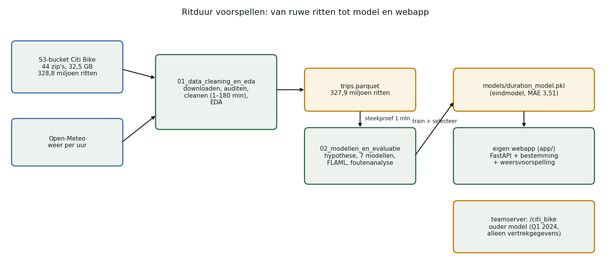

De twee notebooks roepen de code aan in `citi_bike/Brent/src/`: `data/` (downloaden, cleanen, weer, steekproef), `features/` (kenmerken en routehistoriek), `analysis/` (hypothese) en `models/` (training, AutoML, voorspellen). Zo gebruiken de notebooks, de webapp, de tests en het AWS-script exact dezelfde code.

---

## 3. De data

### 3.1 Ritdata van Citi Bike
- **Bron:** de officiële publieke bucket `https://s3.amazonaws.com/tripdata/`, zonder login. De downloader leest de lijst van bestanden uit de bucket en neemt automatisch de **nieuwste** maand (`latest`), zodat de code niet elke maand aangepast moet worden.
- **Inhoud:** één rij per rit: starttijd, eindtijd, start- en eindstation (naam, id, coördinaten), type gebruiker (member of casual), en sinds 2020 het fietstype (klassiek of elektrisch).
- **Omvang:** 44 NYC-bestanden (32,5 GB gezipt), juni 2013 – september 2026, samen **328,8 miljoen ritten**.
- **Waarom alle jaren?** Zo ziet het model alle seizoenen en de veranderingen door de tijd (e-bikes, nieuwe buurten). De chronologische split (§8) zorgt ervoor dat die extra historie geen informatie uit de toekomst naar het verleden laat lekken.

### 3.2 Weerdata van Open-Meteo
- **Archief** voor de training, **weersvoorspelling** voor voorspellingen in de webapp.
- **Variabelen per uur:** temperatuur, relatieve luchtvochtigheid, neerslag en windsnelheid.
- **Eén punt voor heel NYC** (40,71° N, 74,01° W), in **lokale tijd** (`America/New_York`). Elke rit krijgt het weer van zijn startuur.

### 3.3 Wat ontbreekt
Verkeer, evenementen, de echte route die de fietser nam, tussenstops, en de staat van de stations (vol of leeg). Die beperkingen komen terug in §11.

---

## 4. Cleaning: van 329 miljoen naar 328 miljoen ritten

Het eindresultaat is één Parquet-bestand met één rij per geldige rit: **327.931.287 ritten** (99,7% van de ruwe ritten). De regels staan in één bestand, `src/data/prepare.py` ("één bron van waarheid"), en het notebook voert daarna controles uit.

### 4.1 Downloaden met controle
- Elk zip-bestand wordt na het downloaden **gecontroleerd** (`testzip`: zijn alle delen leesbaar, en zit er wel een CSV of zip in?). Een corrupt bestand doet de pipeline stoppen (*fail-fast*), in plaats van stilzwijgend onvolledige data te verwerken.
- Van elk bestand bewaren we de URL, de grootte en een **SHA-256-checksum** in `manifest.json`: een vingerafdruk van het bestand. Iedereen kan zo controleren dat hij exact dezelfde data heeft.
- `RUN_DOWNLOAD = False` (standaard) laat de bestaande data staan; de download is 32 GB.

### 4.2 Schema-audit
Voor de cleaning begint, lezen we van elke CSV alleen de kolomnamen (zonder de data in het geheugen te laden). Zo worden schema-afwijkingen zichtbaar voor ze problemen geven.

### 4.3 Drie generaties kolomnamen
| Periode | Kolommen (begin) |
|---|---|
| 2013–2019 | `tripduration, starttime, stoptime, start station id, …, usertype, birth year, gender` |
| sommige bestanden 2016–2017 | `Trip Duration, Start Time, Stop Time, …` |
| vanaf 2020 | `ride_id, rideable_type, started_at, ended_at, …, member_casual` |

**Keuze:** alles omzetten naar het schema van vandaag (`canonical_name`): namen naar kleine letters met `_`, `starttime` → `started_at`, `usertype` → `member_casual` (*Subscriber* → member, *Customer* → casual). Ontbreekt `rideable_type` (vóór 2020), dan wordt het `unknown`. Ontbreekt een verplichte kolom, dan stopt de pipeline met een duidelijke fout.

### 4.4 Dubbele maanden in de jaarbestanden
De zip's van 2013 en 2018 bevatten sommige maanden twee keer: als één volledig CSV-bestand én opgesplitst in genummerde delen. **Keuze:** per maand de **ondiepste** versie houden, en bij twee versies op dezelfde diepte het volledige bestand in plaats van de delen. Zonder die stap zouden die maanden dubbel tellen. Controle: het totaal aantal ingelezen rijen (328.800.493) is gelijk aan dat van de vraag-per-zone-pipeline, die de diepste versie neemt.

### 4.5 In stukken lezen
328 miljoen ritten passen niet in het geheugen van een laptop. Elk bestand wordt in stukken van 250.000 rijen gelezen, gecleand en meteen weggeschreven naar één Parquet-bestand (compact kolomformaat, gecomprimeerd met zstd). Geneste zip's worden één voor één tijdelijk uitgepakt.

### 4.6 Datums en ritduur
- Starttijd en eindtijd worden omgezet naar datums (`pd.to_datetime`). Pandas raadt de notatie zelf; in 2014 en 2016 lukte dat niet voor elk stuk en viel het terug op `dateutil` (een waarschuwing in de uitvoer). Dat werkt, want de Amerikaanse notatie (maand eerst) is de standaard, maar het is trager.
- **Ritduur** = eindtijd − starttijd, in minuten (de target).

### 4.7 Wat telt als een geldige rit?
| Regel | Keuze | Waarom |
|---|---|---|
| ritduur **1 tot 180 minuten** | anders weg | korter dan 1 minuut: valse starts, resets of registratiefouten. Langer dan 3 uur: uitzonderingen (fiets niet correct ingeleverd, verloren) die het model zouden domineren. Ook negatieve duren (de klokwissel in november) vallen zo weg |
| startcoördinaten binnen NYC (40,4–41,1 / −74,4 – −73,5) | anders weg | foute of ontbrekende locaties (0,0) |
| klanttype `member` of `casual` | anders weg | alleen die twee zijn over alle jaren vergelijkbaar; het klanttype is een kenmerk van het model |
| starttijd en startstation gekend | anders weg | nodig voor een voorspelling bij vertrek |
| geen eindstation | **behouden** | de rit heeft nog een geldige duur; het model vult ontbrekende waarden aan |
| dubbele `ride_id` | weg (binnen een stuk) | dezelfde rit niet dubbel tellen. Oude ritten (vóór 2020) hebben geen `ride_id` en krijgen een eigen nummer per bestand en rij |

De grenzen zijn **vooraf** gekozen als plausibiliteitsregels, niet afgestemd op een gunstige modelscore. De audit telt de redenen **niet exclusief**: één rij kan tegelijk een ongeldige duur én locatie hebben. Daarom tellen de redenen niet op tot het totaal.

**Resultaat:** 327.931.287 van 328.800.493 ritten blijven over (**99,7%**).

### 4.8 Controles na de cleaning
Op een steekproef van 1 miljoen ritten controleert het notebook met `assert`s: het aantal rijen in het bestand klopt met de audit, elke `ride_id` is uniek, elke duur ligt tussen 1 en 180 minuten, elk klanttype is member of casual, elke startlocatie ligt in NYC, en starttijd en startstation zijn altijd gekend.

### 4.9 Ontbrekende waarden na de cleaning
In de steekproef ontbreken alleen eindgegevens: eindstation 0,13%, eindcoördinaten 0,12%. Alle andere kolommen zijn volledig.

---

## 5. Feature engineering: wat weet het model bij vertrek?

De basisregel: het model mag alleen informatie gebruiken die **bij vertrek bekend** is (geen *leakage*). De eindtijd en de ritduur zelf zijn dus taboe. De **bestemming** is een productaanname: de gebruiker geeft vooraf aan waar hij naartoe gaat. Zonder bestemming mogen het eindstation en de afgeleide afstand niet gebruikt worden.

| Groep | Kenmerken | Uitleg |
|---|---|---|
| gebruiker en fiets | `rideable_type`, `member_casual` | categorieën |
| stations | `start_station_id`, `end_station_id`, coördinaten van start en bestemming | categorieën en getallen |
| afstand | `direct_distance_km` | **Haversine-afstand**: de afstand in rechte lijn over het aardoppervlak; een ondergrens voor de echte route |
| | `grid_distance_km` | afstand langs het stratenrooster van Manhattan (assen 29° gedraaid, "Manhattan-afstand"): benadert beter dat straten niet in een rechte lijn lopen |
| richting | `delta_lat`, `delta_lng`, `bearing_sin`, `bearing_cos` | noord-zuid- en oost-westverplaatsing, en de reisrichting als sinus en cosinus |
| routehistoriek | `route_typical_minutes`, `route_history_log_count`, `start_typical_minutes`, `end_typical_minutes` | de typische duur op deze route en vanaf/naar deze stations, **alleen berekend uit eerdere ritten** (zie hieronder) |
| tijd | `start_hour_sin/cos`, `weekday_sin/cos`, `month_sin/cos`, `is_weekend`, `is_holiday` | **cyclische codering**: 23u en 0u liggen naast elkaar op een cirkel, niet ver uit elkaar zoals de getallen 23 en 0 |
| weer | `temperature_2m`, `relative_humidity_2m`, `precipitation`, `wind_speed_10m` | het weer op het startuur |

### 5.1 Routehistoriek zonder leakage
De typische duur op een route (start → bestemming) is een heel sterk kenmerk, maar ook gevaarlijk: als de duur van de rit zelf in het gemiddelde zit, kent het model het antwoord.
- **In de training** gebruikt elke rit alleen de ritten **ervoor** (een "expanding" gemiddelde, chronologisch).
- **Bij validatie, test en voorspelling** gebruikt het model de gemiddelden uit de trainingsperiode.
- **Smoothing** met 20 pseudo-waarnemingen: een route met maar 2 eerdere ritten krijgt een gemiddelde dat sterk naar het globale gemiddelde getrokken wordt. Zo krijgen zeldzame routes geen extreme, toevallige schatting.

### 5.2 Geen unsupervised learning
In dit deel is geen clustering gebruikt (zoals KMeans bij de vraag per zone). Stations blijven afzonderlijke categorieën; de locatie zit in de coördinaten en de afstand.

---

## 6. EDA: wat bepaalt de ritduur?

De EDA gebruikt een **systematische steekproef** van 1 miljoen ritten: elke ±328e rij, gelijkmatig verspreid over het hele bestand. Zo blijven de grafieken snel en zit elke periode erin. Officiële aantallen komen uit de volledige audit, niet uit de steekproef.

### 6.1 De target
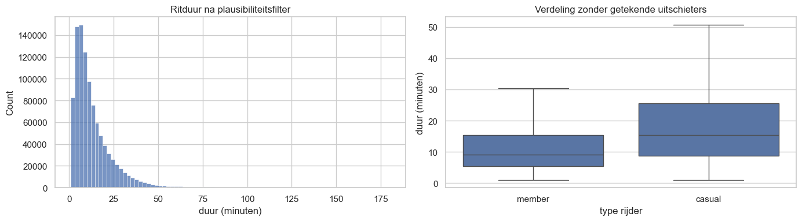

- **Rechtsscheef:** mediaan 9,9 minuten, gemiddelde 13,6, 90% korter dan 27 minuten, 99% korter dan 62 minuten.
- **Casual riders** maken duidelijk langere ritten dan members (rechts).
- **Gevolg:** de **MAE** als hoofdmetric (minder gevoelig voor lange ritten dan een gekwadrateerde fout) en een vergelijking tussen een `log1p`-target en directe training (§9).

### 6.2 Wanneer wordt er gereden?
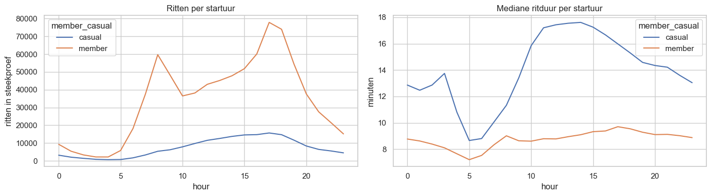

- **Members**: twee spitsen (8u en 17u, woon-werkverkeer) en een vrijwel constante mediane duur van ± 9 minuten.
- **Casual riders**: geen spits, en veel langere ritten midden op de dag (± 17 minuten rond 12–14u): recreatief fietsen.

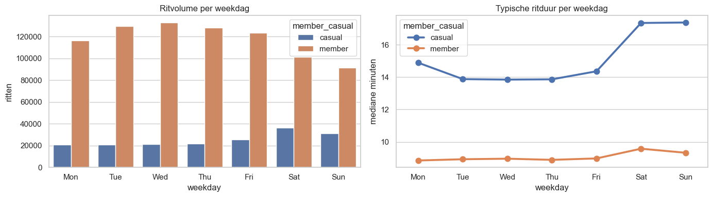

In het weekend zijn de ritten langer, vooral bij casual riders (mediaan ± 14 minuten op weekdagen, ± 17,4 in het weekend; bij members 8,9 tegenover 9,6). Er zijn ook meer casual ritten in het weekend. Daarom zijn `is_weekend` en de weekdag kenmerken.

### 6.3 Seizoen, gebruikers en fietsen
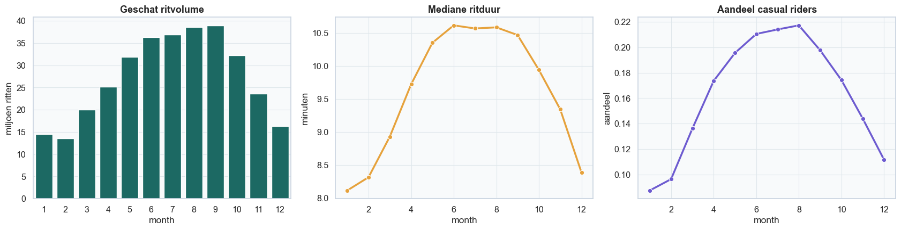

- Het **volume** piekt van juni tot september.
- De **mediane duur** stijgt van ± 8 minuten in de winter naar ± 10,6 in de zomer.
- Het **aandeel casual riders** stijgt van ± 9% in januari naar ± 22% in augustus. Een deel van de langere zomerritten komt dus doordat er dan meer recreatieve fietsers zijn.

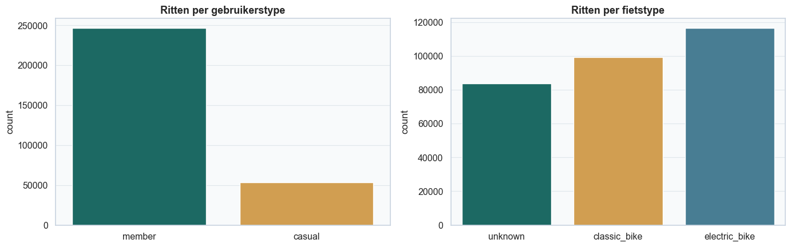

### 6.4 Afstand
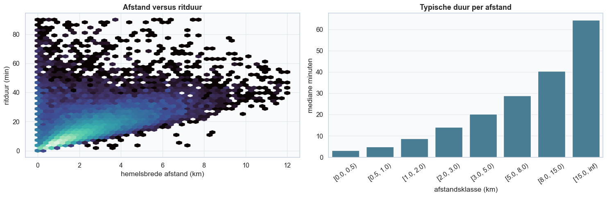

| Afstand in rechte lijn | Mediane duur |
|---|---|
| < 0,5 km | 3,2 min |
| 1–2 km | 8,8 min |
| 3–5 km | 20,2 min |
| 8–15 km | 40,4 min |

De afstand is veruit de sterkste informatie, maar niet perfect: de rechte lijn is geen echte fietsroute.

### 6.5 Weer
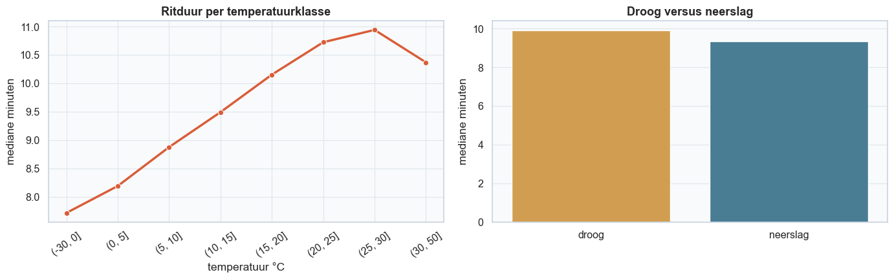

Bij warmer weer zijn de ritten langer (mediaan 7,7 min onder 0 °C, 10,9 min bij 25–30 °C), en bij neerslag iets korter (9,4 tegenover 9,9 min). Dit zijn **associaties**: warm weer valt samen met meer casual riders en recreatieve ritten.

### 6.6 Stations
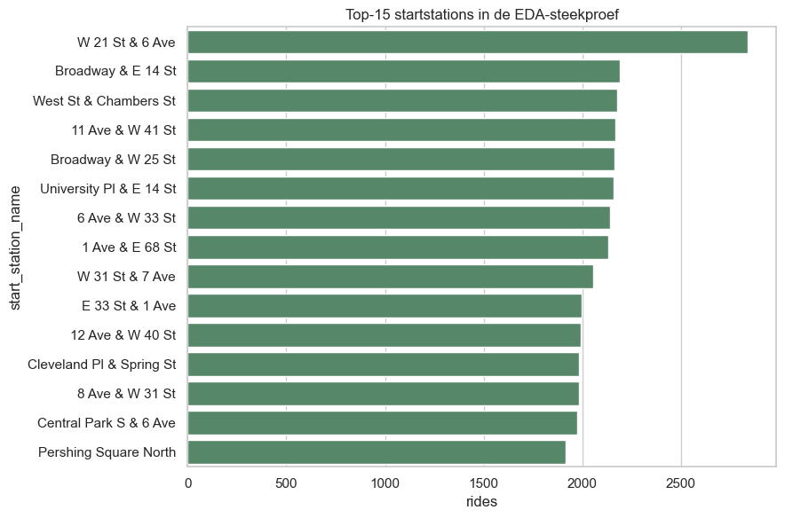

De drukste startstations liggen allemaal in Manhattan (bv. W 21 St & 6 Ave, Broadway & E 14 St, West St & Chambers St). Stations langs het water en aan Central Park (12 Ave & W 40 St, Central Park S & 6 Ave) hebben een duidelijk langere mediane duur (17–20 minuten): daar wordt recreatief gefietst. Voor de mediane duur tellen alleen stations met minstens 500 ritten, anders domineren toevallige uitschieters.

---

## 7. Statistiek: de hypothese

Vóór het modelleren toetsten we of het klanttype echt samenhangt met de ritduur.

- **H₀:** de ritduur heeft dezelfde verdeling voor casual riders en members.
- **H₁ (eenzijdig):** casual riders maken langere ritten.
- **α = 0,05.**

**Waarom deze toetsen?** De ritduur is sterk rechtsscheef, dus een t-toets (die een normale verdeling en gemiddelden veronderstelt) past niet. Daarom:
- **Mann–Whitney U-toets**: een niet-parametrische toets die twee onafhankelijke groepen vergelijkt via rangen. Op een steekproef van maximaal 200.000 ritten per groep;
- **verschil in medianen** met een **95%-bootstrap-interval** (2.000 keer hertrekken): de praktische grootte in minuten;
- **Cliff's delta**: een effectgrootte zonder eenheid, P(casual > member) − P(casual < member), tussen −1 en 1.

| | Resultaat |
|---|---|
| Mediane duur casual | 15,35 min (n = 177.448) |
| Mediane duur member | 9,04 min (n = 822.343) |
| Verschil | **+6,31 minuten** (95%-BI 5,96 tot 6,66) |
| Mann–Whitney, eenzijdige p | < 10⁻³⁰⁰ (kleiner dan de rekenprecisie, gerapporteerd als 0) |
| Cliff's delta | **0,35** (middelgroot effect) |

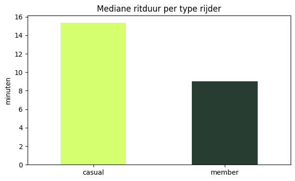

**Conclusie:** H₀ verworpen. Casual riders fietsen typisch 6,3 minuten langer, en dat is praktisch relevant (meer dan de helft van een gewone memberrit). Dit motiveert `member_casual` als kenmerk. Het is wel een **associatie**, geen oorzaak: casual riders fietsen ook vaker in het weekend, in de zomer en op andere routes.

**p-waarde en effectgrootte:** met honderdduizenden ritten wordt elk verschil "significant". Daarom rapporteren we altijd ook hoe groot het verschil is (minuten, Cliff's delta) en met welk betrouwbaarheidsinterval.

---

## 8. Hoe we modellen eerlijk meten

### 8.1 Steekproef
Voor de modellen gebruiken we dezelfde systematische steekproef van **999.791 ritten** over de hele periode. Zo blijven geheugen en rekentijd beheersbaar, en zien alle modellen exact dezelfde data.

### 8.2 Geneste chronologische split
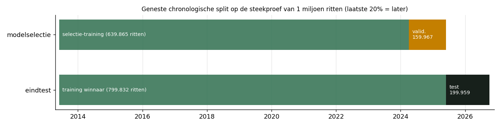

- **Eindtest (hold-out):** de laatste 20% van de ritten in de tijd (30 mei 2025 – 30 september 2026, 199.959 ritten). Die gebruiken we **één keer**, voor het gekozen model.
- **Modelselectie:** binnen de eerste 80% opnieuw chronologisch splitsen: de laatste 20% daarvan (5 april 2024 – 30 mei 2025, 159.967 ritten) is de **validatie**, de rest (639.865 ritten) de **selectie-training**.
- **Waarom chronologisch?** Een random split zou toekomstige stations, routes en gedrag naar de training lekken. In het echt voorspelt het model altijd vooruit.

### 8.3 Metrics
| Metric | Wat | Waarom |
|---|---|---|
| **MAE** | gemiddelde absolute fout in minuten | primaire metric, uit te leggen ("± 3,5 minuten ernaast") en minder gevoelig voor lange ritten |
| **RMSE** | wortel van de gemiddelde gekwadrateerde fout | toont of er grote missers zijn |
| **MedAE** | mediane absolute fout | de fout voor een "typische" rit |
| **R²** | aandeel van de variatie dat het model verklaart | algemeen beeld |

### 8.4 Selectieregel (vooraf vastgelegd)
Eerst de laagste validatie-MAE. Modellen binnen **0,10 minuut** (6 seconden) van de beste gelden als praktisch gelijk; daartussen kiest de hoogste R². Zo beslist een verwaarloosbaar MAE-verschil niet alleen over de winnaar.

---

## 9. De modellen

### 9.1 Drie manieren om de target te behandelen
- **`log1p`-target:** het model leert `log(1 + duur)` en zet de voorspelling terug naar minuten. Dat drukt de lange rechterstaart in.
- **Raw (gekwadrateerde fout):** het model voorspelt minuten en minimaliseert de gekwadrateerde fout: het mikt op het **gemiddelde**.
- **Absolute fout:** het model minimaliseert de absolute fout: het mikt op de **mediaan**, precies wat de MAE meet.

Elke voorspelling wordt begrensd op 0–180 minuten, het geldige bereik.

### 9.2 Preprocessing
- **Boommodellen:** categorieën met een `OrdinalEncoder` (elke categorie een getal; onbekende stations krijgen −1), ontbrekende categorieën met de meest voorkomende waarde, ontbrekende getallen met de mediaan.
- **Ridge:** categorieën met **one-hot encoding** (één 0/1-kolom per categorie, zeldzame categorieën met minder dan 5 voorbeelden samen), getallen geschaald.

### 9.3 Resultaten op de validatie
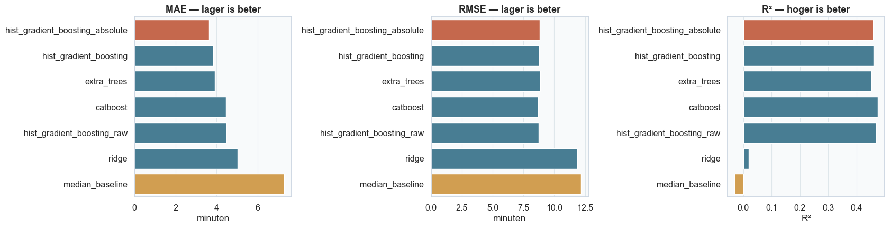

| Model | Target | MAE | RMSE | MedAE | R² |
|---|---|---|---|---|---|
| Mediaanbaseline | log | 7,30 | 12,16 | 5,14 | −0,03 |
| Ridge | log | 5,01 | 11,87 | 2,29 | 0,02 |
| Extra Trees | log | 3,92 | 8,85 | 2,01 | 0,454 |
| HistGB | log | 3,83 | 8,79 | 1,91 | 0,461 |
| HistGB | raw | 4,49 | 8,72 | 2,74 | 0,470 |
| CatBoost | raw (RMSE) | 4,44 | 8,68 | 2,69 | **0,475** |
| **HistGB** | **absolute fout** | **3,62** | 8,82 | **1,52** | 0,458 |

#### Mediaanbaseline
- **Wat:** voorspel voor elke rit de mediane duur uit de training.
- **Waarom:** een model is pas nuttig als het duidelijk beter doet dan "altijd hetzelfde zeggen".
- **Resultaat:** MAE 7,30 minuten, R² −0,03.

#### Ridge (lineaire regressie met L2-regularisatie)
- **Wat:** een lineair model met een straf op grote coëfficiënten (`alpha = 10`).
- **Waarom:** test of een eenvoudige lineaire relatie volstaat.
- **Resultaat:** MAE 5,01 maar R² 0,02: de duur hangt niet lineair af van de kenmerken (de afstand bv. wel, maar het effect hangt af van gebruiker, tijdstip en route).

#### Extra Trees
- **Wat:** veel bomen met willekeurige splitpunten, gemiddeld (*bagging*).
- **Resultaat:** MAE 3,92. Kan complexe patronen leren, maar overfit gemakkelijker en is groot.

#### CatBoost
- **Wat:** gradient boosting met ingebouwde verwerking van categorieën (stations als echte categorieën).
- **Resultaat:** de hoogste R² (0,475) en laagste RMSE, maar een MAE van 4,44: het optimaliseert de gekwadrateerde fout.

#### Histogram Gradient Boosting (gekozen)
- **Wat:** bomen **na elkaar**, elke nieuwe boom leert de fouten van de vorige (*boosting*); de histogram-variant deelt elke kolom in maximaal 255 bakjes in, snel op honderdduizenden rijen.
- **Instellingen:** vaste, conservatieve waarden (learning rate 0,06, 250 bomen, 31 bladeren per boom, minstens 30 ritten per blad, L2-regularisatie 2), **niet** getuned op de eindtest. De vergelijking van de drie targets was belangrijker dan een grote zoektocht.
- **Resultaat:** met absolute fout **MAE 3,62** en **MedAE 1,52** op de validatie: het beste op de primaire metric, en 50% beter dan de baseline.

### 9.4 Waarom wint de absolute fout op MAE, maar niet op R²?
De ritduur is rechtsscheef: het gemiddelde ligt boven de mediaan. Een model met absolute fout voorspelt de **mediaan**, en dat geeft de laagste MAE. Een model met gekwadrateerde fout voorspelt het **gemiddelde**, en dat geeft de laagste RMSE en de hoogste R². Omdat de MAE vooraf de primaire metric was, wint de absolute fout. De selectieregel (§8.4) kon de R² niet laten beslissen: het volgende model (HistGB log, 3,83) ligt meer dan 0,10 minuut achter.

### 9.5 Eindtest
Alleen het gekozen model wordt opnieuw getraind op de eerste 80% (799.832 ritten) en één keer gemeten op de eindtest:

| | MAE | RMSE | MedAE | R² |
|---|---|---|---|---|
| **Eindtest (jun 2025 – sep 2026)** | **3,51** | 8,75 | 1,39 | **0,454** |
| Ter vergelijking: validatie | 3,62 | 8,82 | 1,52 | 0,458 |

De eindtest is even goed als de validatie: het model generaliseert naar een latere periode.

---

## 10. AutoML met FLAML

**Waarom:** een onafhankelijke controle. Vindt AutoML een beter model dan de handmatige keuze?

**Waarom FLAML en niet PyCaret?** FLAML (Microsoft) werkt met de Python-versie van dit project; PyCaret werkt alleen tot Python 3.11.

**Eerlijke vergelijking:** FLAML kreeg exact dezelfde 639.865 trainingsritten, dezelfde 159.967 validatieritten, dezelfde kenmerken en de MAE als doel. De eindtest bleef erbuiten.
- **Modellen:** HistGB, Extra Trees, random forest, CatBoost en XGBoost. LightGBM is uitgesloten: die crashte op Windows met Python 3.13 en zou de hele zoektocht afbreken.
- **Budget:** 15 minuten in totaal, hooguit 3 minuten per poging: zo zijn de kosten reproduceerbaar.
- `RUN_AUTOML = False` (standaard) leest de bewaarde resultaten in plaats van de run te herhalen.

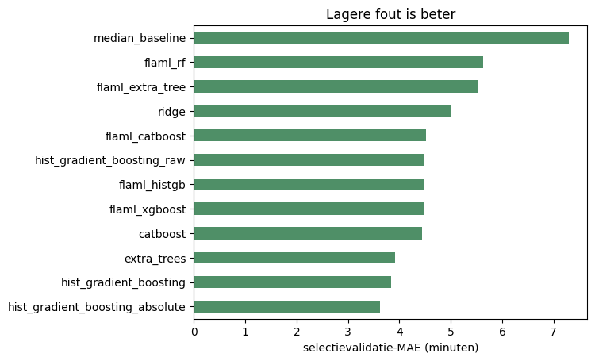

| FLAML-model | Beste validatie-MAE |
|---|---|
| XGBoost (gekozen door FLAML) | 4,48 |
| HistGB | 4,48 |
| CatBoost | 4,52 |
| Extra Trees | 5,53 |
| Random forest | 5,64 |

**Resultaat:** FLAML vond geen beter model: 4,48 tegenover **3,62** voor de handmatige HistGB met absolute fout. Opvallend: de FLAML-modellen liggen allemaal rond 4,5, net als de handmatige modellen met gekwadrateerde fout (HistGB raw 4,49, CatBoost 4,44). De meest waarschijnlijke verklaring is de **verliesfunctie**: FLAML kiest en tunet de modellen op de MAE, maar de modellen zelf trainen met hun standaardverlies, de gekwadrateerde fout (ze voorspellen het gemiddelde). De winnaar optimaliseert rechtstreeks de absolute fout.

**Verder?** **Nee.** Omdat FLAML niet won, is de eindtest terecht niet opnieuw gebruikt voor een tweede modelkeuze.

---

## 11. Foutenanalyse

### 11.1 Training tegenover eindtest
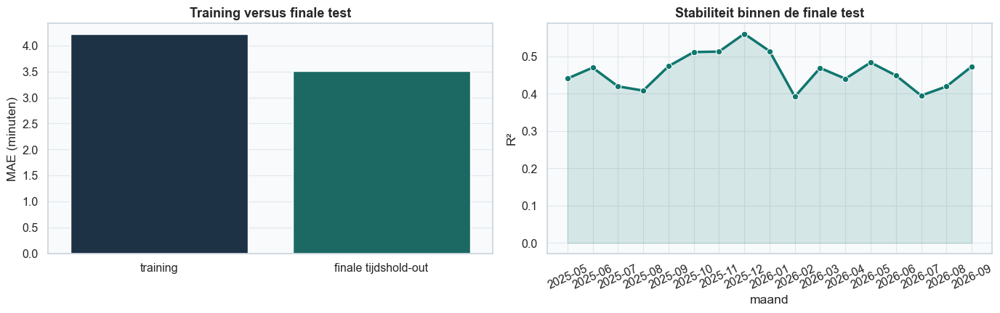

- MAE op de training 4,22, op de eindtest 3,51. Dat de training **slechter** scoort, is geen fout: de trainingsperiode bevat de oudere jaren (met langere ritten zonder e-bikes) en de eerste ritten van elke route, waarvoor nog geen historiek bestond (het expanding gemiddelde begint leeg). Er is dus geen teken van overfitting.
- De **R² per maand** in de eindtest ligt tussen 0,39 en 0,56: stabiel door de tijd.

### 11.2 Per maand
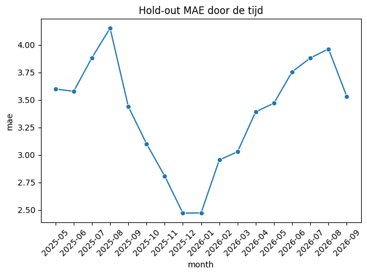

De fout is het kleinst in de winter (2,5 minuten in december en januari) en het grootst in de zomer (tot 4,2 minuten in augustus 2025): dan zijn er meer casual riders en recreatieve ritten, die moeilijker te voorspellen zijn.

### 11.3 Per subgroep
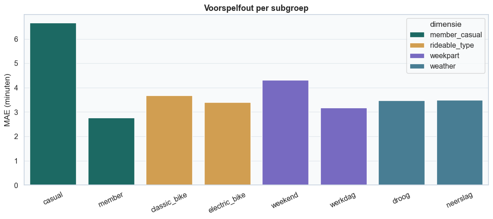

| Groep | MAE | Bias (voorspelling − werkelijk) |
|---|---|---|
| casual | **6,66** | −3,71 |
| member | 2,77 | −1,41 |
| klassieke fiets | 3,67 | −1,89 |
| e-bike | 3,40 | −1,81 |
| weekend | 4,32 | −2,37 |
| werkdag | 3,17 | −1,64 |
| droog | 3,48 | −1,83 |
| neerslag | 3,50 | −1,87 |

- **Casual riders** zijn veruit het moeilijkst (MAE meer dan dubbel zo groot), vooral met een klassieke fiets in het weekend (8,6 minuten). Wie toeristisch rondrijdt, stopt onderweg of neemt een omweg; dat staat nergens in de data.
- **De bias is overal negatief**: het model voorspelt gemiddeld te kort. Dat is een gevolg van de absolute fout: het model voorspelt de mediaan, en bij een rechtsscheve verdeling ligt het gemiddelde hoger.
- **Neerslag** maakt voor de fout geen verschil.

### 11.4 Werkelijk tegenover voorspeld
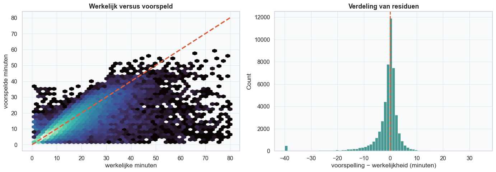

De meeste ritten liggen dicht bij de diagonaal. De grootste fouten zijn allemaal ritten van **2 tot 3 uur** die het model op 2 tot 35 minuten schat: korte afstanden (vaak minder dan 2 km, soms een rit die terugkeert naar het startstation) die lang duurden. Dat zijn tussenstops, omwegen of een fiets die te laat werd ingeleverd: onvoorspelbaar bij vertrek.

### 11.5 Permutation importance
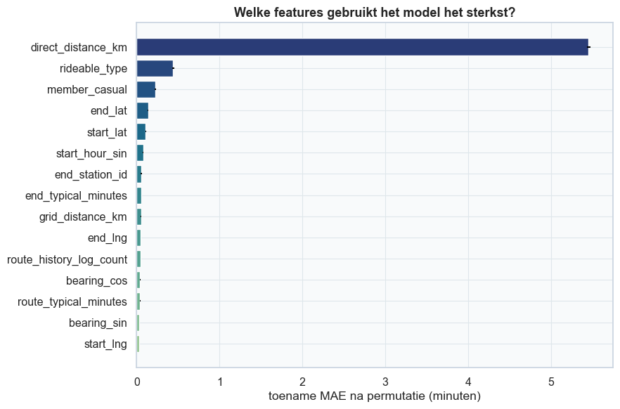

We husselen één kenmerk door elkaar (op 12.000 ritten uit de eindtest, 3 herhalingen) en meten hoeveel de MAE stijgt:

| Kenmerk | MAE-stijging (minuten) |
|---|---|
| `direct_distance_km` | **5,45** |
| `rideable_type` | 0,44 |
| `member_casual` | 0,23 |
| `end_lat` | 0,14 |
| `start_lat` | 0,11 |
| `start_hour_sin` | 0,08 |
| `end_station_id`, `end_typical_minutes`, `grid_distance_km` | ± 0,05 |
| weer, maand, weekend, feestdag | ± 0 |

- De **afstand** is veruit het belangrijkst, dan het **fietstype** (e-bikes rijden sneller) en het **klanttype**.
- **Weer, maand en weekend scoren ± 0.** Dat betekent niet dat ze geen samenhang hebben (§6.5), maar dat het model die informatie al uit andere kenmerken haalt (bv. het klanttype en het uur), of dat het effect klein is naast de afstand.
- **Gecorreleerde kenmerken** delen hun belang: de directe afstand, de rasterafstand en de routehistoriek bevatten deels dezelfde informatie. Husselt men er één, dan vangen de andere het deels op. Dit is dus geen causale ranglijst.

---

## 12. Deployment

### 12.1 Het eindmodel op de teamserver
Het eindmodel (30 kenmerken, MAE 3,51) draait op de teamserver onder `/citi_bike`, met de pagina `citi_bike.html`. Daarvoor waren twee dingen nodig:

1. **Dezelfde bibliotheekversies als de server.** Alle modellen draaien in één proces met scikit-learn 1.4.2 en numpy 1.26.4 (de versies die PyCaret 3.3 vereist, zie de hoofd-README). Een `.pkl`-bestand bewaart de interne opbouw van de Python-objecten; een model opgeslagen met scikit-learn 1.6.1 kon de server niet openen (`_RemainderColsList` bestaat pas sinds 1.5). Het eindmodel is daarom opnieuw getraind met Python 3.12, scikit-learn 1.4.2 en numpy 1.26.4, met exact dezelfde code en data; de resultaten zijn dezelfde (MAE 3,51). De gebruikte versies staan nu in de bundle (`runtime_versions`).
2. **Dezelfde kenmerken in de API als in de training.** Alleen de map `deploy/` gaat naar de server, dus de berekening van de 30 kenmerken (afstand en richting, routehistoriek, tijd, feestdag) staat opnieuw in `deploy/citi_bike/api.py`. Een test vergeleek 500 willekeurige ritten: de voorspellingen van de API en van `src/models/predict.py` zijn identiek.

| | Teamserver (`/citi_bike`) | Eigen webapp (`citi_bike/Brent/app/`) |
|---|---|---|
| Model | het eindmodel | het eindmodel |
| Invoer | vertrekmoment, fietstype, klanttype, start- en eindstation (op naam gekozen uit `GET /citi_bike/stations`, 2.423 huidige stations) | idem, met id's en coördinaten |
| Weer | de pagina haalt de weersvoorspelling bij Open-Meteo; zonder voorspelling (bv. meer dan 2 weken vooruit) vult het model de mediaan uit de training in | de app haalt de voorspelling zelf |
| Antwoord | duur in minuten, afstand in rechte lijn, aantal eerdere ritten op de route, gemiddelde fout op de eindtest | duur en bron van het weer |

**Eén aanpassing tegenover de trainingscode:** `make_features` zoekt feestdagen tussen het eerste en het laatste vertrekmoment, inclusief kloktijd. Bij de training (ritten over jaren) is dat juist, maar bij één voorspelling (bv. 4 juli om 8u30) zou de feestdag (4 juli 0u00) buiten dat bereik vallen. De API zoekt daarom op hele dagen; dat geeft dezelfde waarde als bij de training.

### 12.2 Onderdelen
| Onderdeel | Wat het doet |
|---|---|
| **`src/models/train.py`** | traint en vergelijkt alle modellen, kiest de winnaar volgens de selectieregel, meet die één keer op de eindtest, en schrijft een **bundle** weg met **pickle** (model, kenmerken, metrics, periodes, selectieregel, routehistoriek, beperkingen) plus een metadata-JSON |
| **`src/models/predict.py`** | laadt de bundle, berekent de routehistoriek en de kenmerken, en begrenst de voorspelling op 0–180 minuten |
| **FastAPI + Pydantic** (eigen app) | `GET /health`, `POST /predict`, model-card; Pydantic controleert de invoer (bv. coördinaten in NYC, klanttype member/casual) |
| **Webinterface** (`app/static/`) | formulier en resultaat, met de bron van het weer |
| **Teamserver** (`deploy/citi_bike/`) | dezelfde Oracle VM, `deploy-api.yml` en smoke test als de vraag per zone; `check_model.py` test vóór elke deploy o.a. dat een verdere bestemming een langere rit geeft en dat een rit zonder bestemming geweigerd wordt (HTTP 422); pagina `citi_bike.html` |
| **Tests** (`tests/`, pytest) | data, kenmerken, routehistoriek, steekproef, weer, AutoML en de API |
| **AWS** (`aws/train_entrypoint.py`) | hetzelfde `train_and_compare` als SageMaker-trainingsjob: leest de Parquet-data uit `SM_CHANNEL_TRAIN` en schrijft model en metrics naar `SM_MODEL_DIR` |

---

## 13. Wat niet werkte, en wat we ervan leerden

| Wat | Wat er gebeurde | Les |
|---|---|---|
| Eerste model (alleen vertrekgegevens, Q1 2024) | MAE 6,69, R² 0,05: zonder bestemming is de duur bij vertrek bijna niet te voorspellen | de **bestemming** (afstand) is de sleutel; daarom werd ze een productaanname. (Dat eerste model gebruikte ook minder data en geen weer, dus het is geen zuivere vergelijking.) |
| Conclusie van de hypothese in het notebook | de cel "Beslisregel en conclusie" vraagt nog om de conclusie in te vullen ("Noteer hier na uitvoering …") | de conclusie staat in §7 van dit document; Brent kan ze in het notebook zetten |
| Gekwadrateerde fout | beste R², maar slechtere MAE | kies de verliesfunctie die past bij de metric die je wil verbeteren |
| FLAML | 4,48 tegenover 3,62 | AutoML met standaardinstellingen verslaat geen goed gekozen verliesfunctie |
| LightGBM | crashte op Windows/Python 3.13 | runtime-problemen eerlijk vermelden en het model uitsluiten in plaats van de hele run te laten falen |
| Datums zonder vaste notatie | waarschuwingen en terugval op `dateutil` in 2014 en 2016 | een vaste notatie per bestand is sneller en controleerbaar |
| Station-id's als getal ingelezen | dezelfde id kan als `354` of `354.0` voorkomen, en oude en nieuwe id's (`72`, `6926.01`) worden niet gekoppeld | lees id's als tekst in en herstel ze; het effect op de MAE is waarschijnlijk klein (stations scoren laag in de permutation importance, de afstand vangt de locatie op), maar het is niet gemeten |
| Interne stations | depots en werkplaatsen (± 18.800 ritten) zijn niet weggefilterd | voor de ritduur geen klantritten; een filter zoals bij de vraag per zone zou ze weglaten |
| Eindmodel op de teamserver | eerst niet te laden (getraind met scikit-learn 1.6.1, server 1.4.2) en de server-API berekende maar 12 van de 30 kenmerken | opnieuw getraind met de versies van de server, en de API berekent nu dezelfde kenmerken als de training (getest: identieke voorspellingen). Les: train wat naar de server gaat altijd met dezelfde bibliotheekversies |

---

## 14. Tools en versies

| Tool | Versie | Gebruikt voor |
|---|---|---|
| Python | 3.12 (eindmodel; 3.11–3.12 ondersteund) | alles |
| pandas | 2.2.3 | tabellen, groeperen, tijdreeksen |
| numpy | 1.26.4 (zelfde als de server) | rekenen |
| pyarrow | 18.1.0 | Parquet lezen en schrijven (in stukken) |
| requests | 2.32.3 | downloaden, Open-Meteo |
| scikit-learn | **1.4.2** (zelfde als de server) | HistGB, Extra Trees, Ridge, preprocessing, metrics, permutation importance |
| CatBoost | 1.2.10 | gradient boosting met categorieën |
| FLAML | 2.3.3 | AutoML (met XGBoost) |
| scipy | 1.14.1 | Mann–Whitney U-toets |
| matplotlib, seaborn | 3.10.0, 0.13.2 | grafieken |
| FastAPI, Pydantic, uvicorn | 0.115.6, 2.10.5, 0.34.0 | eigen webapp |
| pytest, httpx | 8.3.4, 0.28.1 | tests |
| JupyterLab, nbformat | 4.3.4, 5.10.4 | notebooks |
| Open-Meteo | | weer (archief en voorspelling) |
| AWS SageMaker | | trainingsjob in de cloud |

---

## 15. Begrippenlijst

| Begrip | Uitleg |
|---|---|
| **Absolute fout (verliesfunctie)** | het model minimaliseert \|voorspelling − werkelijk\| en voorspelt zo de mediaan |
| **AutoML** | automatisch veel modellen proberen en tunen (hier FLAML) |
| **Bagging** | veel modellen onafhankelijk trainen en middelen (Extra Trees) |
| **Baseline** | eenvoudige referentie waar elk model beter moet zijn dan |
| **Betrouwbaarheidsinterval (BI)** | bereik waarin de echte waarde met 95% zekerheid ligt |
| **Bias (van de fout)** | de gemiddelde fout: negatief = het model voorspelt te kort |
| **Boosting** | modellen na elkaar, elk leert de fouten van de vorige |
| **Bootstrap** | herhaald trekken met teruglegging om onzekerheid te schatten |
| **Chronologische split** | trainen op het verleden, testen op een latere periode |
| **Chunking** | data in stukken verwerken omdat ze niet in het geheugen past |
| **Cliff's delta** | effectgrootte tussen −1 en 1: P(X > Y) − P(X < Y) |
| **Cyclische codering** | tijd als sinus en cosinus, zodat 23u en 0u naast elkaar liggen |
| **Data leakage** | het model ziet (een deel van) het antwoord tijdens het leren |
| **Expanding gemiddelde** | gemiddelde van alle eerdere waarnemingen, zonder de huidige |
| **Fail-fast** | de pipeline stopt meteen bij een fout in plaats van verder te werken met slechte data |
| **Gekwadrateerde fout** | het model minimaliseert (voorspelling − werkelijk)² en voorspelt zo het gemiddelde |
| **Haversine-afstand** | afstand in rechte lijn over het aardoppervlak |
| **Hold-out (eindtest)** | data die pas helemaal op het einde één keer gebruikt wordt |
| **Hyperparameter** | instelling die je vóór het trainen kiest (bv. learning rate) |
| **log1p-target** | het model leert log(1 + duur), om de lange staart in te drukken |
| **MAE, RMSE, MedAE, R²** | zie §8.3 |
| **Mann–Whitney U** | niet-parametrische toets voor twee onafhankelijke groepen |
| **One-hot encoding** | één 0/1-kolom per categorie |
| **Ordinal encoding** | elke categorie krijgt een getal (voor boommodellen) |
| **Parquet** | compact kolomformaat voor tabellen |
| **Permutation importance** | belang van een kenmerk = foutstijging na husselen |
| **p-waarde** | kans op zo'n resultaat als H₀ waar is |
| **Regularisatie (L2)** | straf op grote coëfficiënten of bladwaarden tegen overfitting |
| **SHA-256** | vingerafdruk van een bestand |
| **Smoothing** | een gemiddelde van weinig waarnemingen naar het globale gemiddelde trekken |
| **Systematische steekproef** | elke k-de rij nemen, zodat de hele periode vertegenwoordigd is |

---

## 16. Oefenvragen voor het mondeling

**Waarom MAE als hoofdmetric?**
De MAE is in minuten uit te leggen ("± 3,5 minuten ernaast") en minder gevoelig voor de lange ritten in de rechterstaart dan de RMSE. RMSE, MedAE en R² geven aanvullende informatie.

**Waarom is de R² maar 0,45 als de MAE zo goed is?**
De R² wordt sterk beïnvloed door de weinige heel lange ritten (tot 3 uur) die bij vertrek niet te voorspellen zijn (tussenstops, omwegen). De MAE meet de typische rit, en die voorspelt het model goed (mediane fout 1,4 minuten). Bovendien optimaliseert het model de absolute fout, niet de gekwadrateerde.

**Waarom verliest FLAML?**
FLAML's modellen optimaliseren standaard de gekwadrateerde fout en voorspellen dus het gemiddelde. Bij een rechtsscheve target geeft dat een hogere MAE. De handmatige modellen met gekwadrateerde fout scoren even slecht (± 4,5); het verschil zit in de verliesfunctie.

**Is de bestemming geen leakage?**
Nee, op voorwaarde dat de gebruiker ze vooraf opgeeft: dan is ze bij vertrek bekend. Het is een productaanname. Het eerste model, zonder bestemming (en op minder data), haalde maar R² 0,05; de afstand is het belangrijkste kenmerk van het eindmodel.

**Hoe voorkom je leakage in de routehistoriek?**
In de training gebruikt elke rit alleen de ritten ervóór (expanding gemiddelde). Validatie, test en voorspellingen gebruiken alleen de gemiddelden uit de trainingsperiode. Smoothing voorkomt extreme waarden voor zeldzame routes.

**Waarom een chronologische split en geen random split?**
In het echt voorspelt het model altijd vooruit. Een random split zou toekomstige stations, routes en gedrag in de training stoppen en de score te mooi maken.

**Waarom is de trainingsfout hoger dan de testfout?**
De trainingsperiode bevat oudere jaren met langere ritten en de eerste ritten van elke route, zonder historiek. Dat is geen overfitting; overfitting zou net een lage trainingsfout en een hoge testfout geven.

**Waarom de Mann–Whitney-toets en geen t-toets?**
De ritduur is sterk rechtsscheef; een t-toets veronderstelt (bij benadering) normaal verdeelde gemiddelden. Mann–Whitney werkt met rangen en heeft die veronderstelling niet nodig.

**Wat is Cliff's delta?**
De kans dat een willekeurige casual rit langer is dan een willekeurige memberrit, min de kans op het omgekeerde. 0,35 betekent een middelgroot effect.

**Waarom is het weer onbelangrijk in de permutation importance?**
Het model haalt de informatie uit andere kenmerken (klanttype, uur), en naast de afstand is het effect klein. Permutation importance meet wat het model gebruikt, niet of iets in de werkelijkheid samenhangt.

**Waarom moest het eindmodel opnieuw getraind worden voor de server?**
Alle modellen op de server draaien met scikit-learn 1.4.2 en numpy 1.26.4. Een `.pkl`-bestand bewaart de interne opbouw van de objecten van één bepaalde versie; het model van scikit-learn 1.6.1 kon de server niet openen. Opnieuw getraind met dezelfde code en data in de versies van de server, gaf het dezelfde MAE (3,51).

**Wat zijn de belangrijkste beperkingen?**
Geen echte route, geen tussenstops, geen verkeer of evenementen, het weer op één punt in de stad, en de bestemming moet vooraf gekend zijn.

---

## 17. Bestanden

**In deze map:**

| Bestand | Inhoud |
|---|---|
| `01_data_cleaning_en_eda.ipynb` | downloaden, audit, cleaning, controles en EDA |
| `02_modellen_en_evaluatie.ipynb` | hypothese, modellen, FLAML, foutenanalyse en dashboard |
| `UITLEG.md` | dit document |
| `img/` | grafieken (uit de notebooks) en schema's in dit document |

**Uitvoeren:** de notebooks zoeken in hun eigen map en de mappen erboven naar een map met `pyproject.toml` en `src/`. Vanuit `final/citi_bike/citi_bike_duration/` vinden ze die niet. Voer ze daarom uit vanuit `citi_bike/Brent/notebooks/gecombineerd/` (dezelfde notebooks), met de omgeving uit `citi_bike/Brent/requirements.txt`. `RUN_DOWNLOAD = False` en `RUN_AUTOML = False` hergebruiken de bestaande data en AutoML-resultaten.

**Elders in de repository `CloudAI-Challenge`:**

| Pad | Inhoud |
|---|---|
| `citi_bike/Brent/src/` | alle code: `data/` (download, cleaning, weer, steekproef), `features/` (kenmerken, routehistoriek), `analysis/` (hypothese), `models/` (training, AutoML, voorspellen) |
| `citi_bike/Brent/models/` | het eindmodel (`duration_model.pkl`) en de metadata |
| `citi_bike/Brent/reports/` | metrics, AutoML-resultaat, hypotheseresultaat, metrics per maand |
| `citi_bike/Brent/app/` | eigen FastAPI-webapp met het eindmodel |
| `citi_bike/Brent/tests/` | pytest-tests |
| `citi_bike/Brent/aws/` | SageMaker-trainingsscript |
| `citi_bike/Brent/notebooks/` | de oorspronkelijke notebooks 01–08 (de inhoud zit in de twee notebooks in deze map) |
| `deploy/citi_bike/`, `deploy/web/citi_bike.html` | API (met `stations.json`) en pagina op de teamserver (het eindmodel) |

---

*GenAI: de notebooks en de code zijn volgens de notebooks opgesteld met assistentie van GPT-5.6-Luna; dit document is opgesteld met hulp van Claude (Anthropic). Alle keuzes, resultaten en interpretaties moeten door Brent nagekeken en mondeling verdedigd kunnen worden.*
